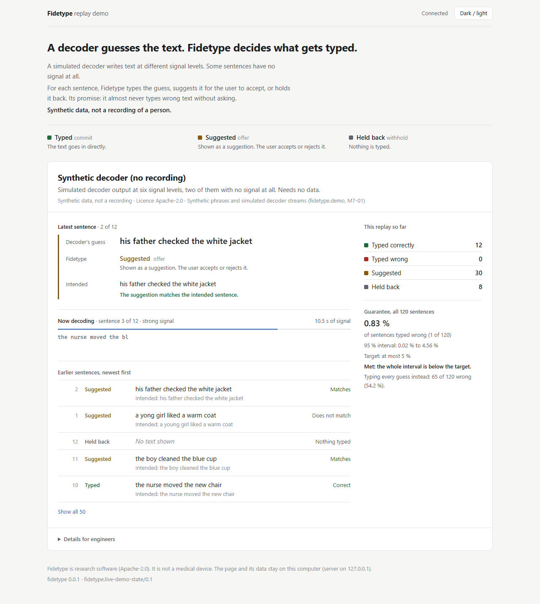

# Live demo: recorded decoder output, trust decisions on screen

`fidetype demo live` starts a small local server and opens a page in your browser. The page replays decoder output that was **recorded earlier**, at the speed it was recorded. For each utterance the trust layer decides:

| On the page | Decision (engineering term) | What the user gets |
|---|---|---|
| **Typed** (green) | COMMIT | the text is typed |
| **Suggested** (amber) | OFFER | the text is only a suggestion; the user accepts or rejects it |
| **Held back** (grey) | WITHHOLD (ABSTAIN, ASK) | nothing is typed |

A wrong commit (typed text that does not match the intended sentence) is marked red.

This is **not** live decoding. The page says "Replay of recorded data, not live decoding" (or "Synthetic data, not a recording").



*The screenshot shows the synthetic track. It contains no participant data.*

## Run it

```sh
pip install ".[ws]"          # the page uses the WebSocket server (websockets, BSD-3-Clause)
fidetype demo live           # default tracks; opens http://127.0.0.1:8770/
fidetype demo live --tracks synthetic     # needs no data
fidetype demo live --check                # which tracks have their data
```

The `fidetype` command is on the PATH only when its virtual environment is active. Without activation, call it from the environment, or use `python -m fidetype` with the environment's Python:

```sh
.venv\Scripts\fidetype.exe demo live          # Windows, from the repository root
.venv/bin/fidetype demo live                  # Linux, macOS
.venv\Scripts\python.exe -m fidetype demo live  # the same, through Python
```

Options: `--speed 2` (twice real time), `--start K` (begin at utterance K), `--no-browser`, `--port N`, `--no-loop`, `--duration S`, `--config FILE`. Press Ctrl+C to stop. The server binds to 127.0.0.1 only. Nothing leaves your computer.

## What the page shows
The top of the page says in three lines what you are watching, with a legend of the three decisions. Then each track has the same parts:

- **Latest sentence:** the decoder's guess (large), the decision (Typed / Suggested / Held back, with the engineering term), and the intended sentence with the result (correct, wrong, matches, does not match). The intended text is used only to score the decisions.
- **Now decoding:** a progress bar for the signal time and the raw decoder output so far (phonemes for the implant track, keys for the EMG track). It is never an action.
- **This replay so far:** typed correctly, typed wrong, suggested and held back.
- **Guarantee:** the wrong-commit rate over all utterances of the track (wrong commits / all utterances) with a 95 % Clopper-Pearson interval, compared with the target alpha, and the "type every guess" baseline. These numbers do not depend on how far the replay is.
- **Earlier sentences:** the newest 5 decisions; "Show all" opens the last 60 in a scroll list.
- **Details for engineers** (closed by default): dataset, licence, signal, decoder, trust configuration and config id, replay speed, median decision time, commits and wrong commits among commits over the whole set, and a table of the last decisions (action, p(top-1), guard risk, latency).
- The dataset link and licence of each track, and "Research use only" where the licence is non-commercial.

## Tracks (default configuration)

| Track | Data | Licence | Decoder and trust configuration |
|---|---|---|---|
| `t15` | Brain-to-Text '25, participant T15 (intracortical), 701 held-out `val_eval` sentences | CC0-1.0 | M4-12 GRU-CTC phoneme decoder + word decoder; recorded decisions of trust config `tcfg-e7e8c472f6d9ab33` (M2-19) |
| `emg2qwerty` | emg2qwerty wrist sEMG, P4-01 baseline streams (8 users x 2 sessions, held-out half), 700 prompts | CC BY-NC-SA 4.0, **research use only** | P4-01 LDA key classifier; trust config fitted by `--prepare emg2qwerty` on the first half of the prompts of each session |
| `synthetic` | simulated decoder streams (M7-01) | Apache-2.0 | packaged demo config |
| `p11-01-emg` | template, disabled | CC BY-NC-SA 4.0 | the P11-01 EMG decoder, when it writes NTS files |

The real tracks read data from `${DATA}` = the environment variable `FIDETYPE_DATA` (default `~/bci-data`). If a file is missing, the command names it and does not start that track. A track that you ask for by name (`--tracks t15`) and that is missing stops the command with exit code 2.

The `emg2qwerty` track needs a one-time preparation (about 15 seconds; it reads only the keylogger attributes of the raw files, not the EMG):

```sh
fidetype demo live --prepare emg2qwerty
```

It writes `truth.json`, `split.json`, the trust configuration and `eval.json` to `${DATA}/derived/p14-06-demo/emg2qwerty/`. These files are derived from research-only data. They never go into the repository.

## Honest numbers (2026-11-15)

| Track | Commits | Wrong commits / all (95 % CI) | Wrong among commits | Always commit, wrong |
|---|---|---|---|---|
| `t15` | 9 of 701 | 6 / 701 = 0.86 % (0.31 % to 1.85 %) | 6 of 9 | 640 of 701 |
| `emg2qwerty` | 3 of 700 | 3 / 700 = 0.43 % (0.09 % to 1.25 %) | 3 of 3 | 700 of 700 |

Both are below the target alpha 0.05, but the commits are rare and most of them are wrong. The decoders are weak: the trust layer keeps the wrong-commit rate low mainly by offering almost everything. M2-19 also found that the T15 config needs the M2-18 commit gate before real use. The page shows these numbers next to the replay.

## Add your own decoder (no code change)

Write your decoder output as NTS files (for CTC logits: `fidetype.adapters.ctc_logits`), freeze a trust configuration (`fidetype.api.calibrate(...).save(...)`), and add a track of kind `nts-streams` to a copy of the configuration file ([`src/fidetype/demo/live/live-demo.json`](../src/fidetype/demo/live/live-demo.json)):

```json
{"id": "my-decoder", "kind": "nts-streams", "title": "My decoder",
 "dataset": {"name": "my recordings", "licence": "CC-BY-4.0"},
 "streams_dir": "${DATA}/my/nts", "trust_config": "${DATA}/my/trust.json", "decoder": "greedy",
 "truth": {"format": "json-map", "path": "${DATA}/my/truth.json", "field": "text"}}
```

Then run `fidetype demo live --config my-demo.json --tracks my-decoder`. `decoder` is `greedy` (CTC greedy), `keys` (key-press streams) or `demo`. Without `truth`, the page says that the wrong-commit rate is unknown. The P11-01 EMG decoder plugs in the same way (template track `p11-01-emg`).

## For app developers

The same server also sends only the `trust_decision` events (FEP-0001) on `ws://127.0.0.1:<port>/decisions` (FEP-0004 binding `nts-ws/0.1`), as an AAC app would read them. The page itself uses `/events` (demo messages) and `/state/state.json`.

## Code
- [`src/fidetype/demo/live/`](../src/fidetype/demo/live/): configuration, tracks, server, key decoder, emg2qwerty preparation, page (`web/index.html`).
- Tests: [`tests/test_demo_live.py`](../tests/test_demo_live.py) (synthetic data only).
