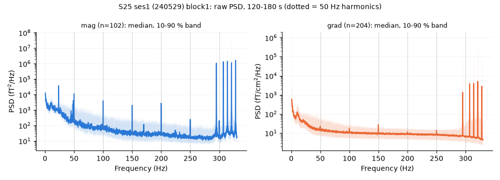
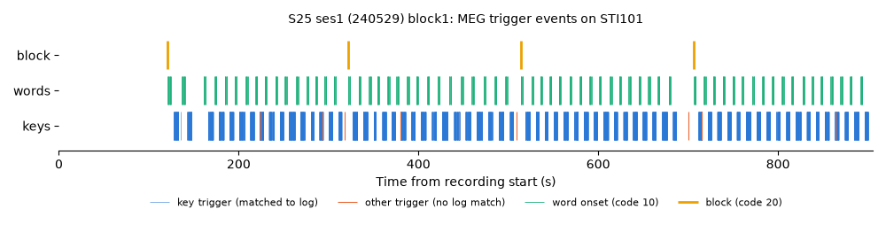

# SpanishBCBL MEG: inspection of S25 (25_12032)

Milestone M0 check: one subject loads in MNE. This page informs the M1 decoder.
The script `inspect_subject.py` made this page. The full log is under "Raw output".

## Summary

| Block | Duration (s) | Channels | Dig (fid/HPI/shape) | Stim | MEG events | Log trials | Log events matched | Residual p95 (ms) |
|---|---|---|---|---|---|---|---|---|
| S25 ses1 (240529) block1 | 908 | 102 mag + 204 grad | 3/5/315 | STI101 | 2557 | 66 | 2548/2548 | 0.9 |
| S25 ses1 (240529) block2 | 979 | 102 mag + 204 grad | 3/5/315 | STI101 | 3434 | 66 | 3415/3415 | 1.0 |
| S25 ses2 (240530) block1 | 982 | 102 mag + 204 grad | 3/5/218 | STI101 | 3439 | 66 | 3428/3429 | 1.0 |
| S25 ses2 (240530) block2 | 779 | 102 mag + 204 grad | 3/5/218 | STI101 | 2601 | 66 | 2581/2581 | 0.9 |

## Key findings for M1

### Keystroke times
- The stim channel STI101 carries one trigger per key press. The trigger value is the key code (`kp.Keycode`, Windows virtual-key code: letters = upper-case ASCII, space = 32, backspace = 8, return = 13).
- Word onsets carry code 10. Block markers carry code 20. Pause markers carry code 30; the log has no times for them.
- Each recording starts with a test ramp (codes 1, 2, 3, ... about 20 ms apart). Drop it before matching.
- The log stores the send time of each trigger: `pr_trials.keyTrig{trial}` for keys, `pr_trials.rsvp{trial}.trigTime` for words, and `pr_trials.blockTrig` for blocks. All three use one clock.
- The log clock and the MEG sample clock drift by 501 ms per 1000 s (slope 1.000501, the same in all blocks). A constant offset is NOT enough: it gives about 0.45 s of error at the end of a 15 min block. Fit offset and slope per block.
- Alignment over all blocks: 11972/11973 log events matched to a MEG trigger with the same code. The worst p95 timing residual is 0.97 ms. The code-sequence match alone gives the same pairs (one block: one pair fewer after the time check).
- Use the MEG trigger onset as the keystroke time. Take the key identity from the log (`kp.CookedKey`), because the trigger value is the virtual-key code (no case, no accents).
- The key trigger comes 8 ms (p5 4, p95 12) after the keyboard-queue time `kp.Time`. This is the delay between key detection and trigger output. The true press time is about the trigger time minus this delay. At 50-100 Hz this is less than one sample, but keep it in mind.

### Sentence text per trial
- `pr_trials.sequence{trial}` holds the target sentence for every trial, including the 2 training trials (trials 0 and 1). `pr_trials.sequences` holds the 64 test sentences only.
- The case varies (training sentences are upper case). Strip trailing spaces, lower-case, and remove accents before use.
- `pr_trials.rsvp{trial}.stim` holds each shown word with its onset (RSVP perception phase).
- The typed text is the sequence of `kp.CookedKey` values. It contains typos and backspaces. The test trials give no visual feedback, so typed text and target can differ.

### Head digitisation
- Yes. Each block has 3 fiducials, 5 HPI coil points and 315 head-shape points (session 2 has fewer), plus a valid `dev_head_t`.
- No MRI exists in the dataset. Source-space work must use a template (fsaverage) fitted to the head shape.
- The head position changes by about 7 mm between sessions (see the raw output). Pooling sessions needs a common head position (`maxwell_filter(destination=...)`).

### Data quality
- The data is raw MaxShield data (IAS on, 11 IAS channels). No SSS was applied. MNE loads it only with `allow_maxshield=True`. Apply `mne.preprocessing.maxwell_filter` (SSS or tSSS) before analysis. The dataset has no fine-calibration or cross-talk files, so SSS runs without them.
- The raw amplitude is high before SSS (median RMS 2223 fT for mag, 266 fT/cm for grad). We expect high values before SSS. Check the RMS again after SSS.
- cHPI coils were on at [295.0, 307.0, 314.0, 321.0, 328.0] Hz (peaks about 47 dB). A low-pass below 45 Hz removes them. They also allow head-movement estimation with `mne.chpi`.
- Line noise: the median-channel 50 Hz peak is 17.4 dB (mag) and 1.5 dB (grad) above its neighbours. Harmonics at 100, 150 and 200 Hz are as strong on mag. See `results/psd.png`.
- Other narrow peaks (Hz, prominence dB): mag [(23.3, 32.0), (48.8, 14.3), (48.0, 11.6), (1.8, 8.7), (44.8, 7.9)]; grad [(1.2, 16.2)]. Peaks that show on mag but not on grad come from distant sources (environment), and SSS should reduce them. A peak inside 0.5-45 Hz stays after the band-pass, so check it again after SSS.
- Flat channels: 0. Robust-z outliers by RMS: 51 (they cluster in a few sensor groups, which suggests external interference before SSS, not broken sensors). The Maxwell scan finds: {'noisy': [], 'flat': []}.
- The header lists no bad channels. Run the Maxwell bad-channel scan per block before SSS.

### Recommended preprocessing for M1
1. Load each typing block with `allow_maxshield=True`. Mark bads with `find_bad_channels_maxwell`.
2. Apply `maxwell_filter` (tSSS, `st_duration=10`, origin from the head shape) with one `destination` per subject. Optionally use cHPI head-movement compensation.
3. Use the v2 recipe as the default: notch 50 Hz (and 100 Hz), band-pass 0.5-45 Hz, resample to 100 Hz. Keep the v1 recipe (0.1-20 Hz, resample to 50 Hz) as a baseline variant.
4. Get keystroke times from the MEG triggers. Join key identity and sentence text from the log with the alignment above.
5. Epoch around each key-press trigger (for example -0.5 to +0.5 s).
6. Use MEG channels only (102 mag + 204 grad). Keep EOG/ECG for artefact rejection (ICA or regression).
7. Keep trials 0 and 1 of each block out of test metrics (training trials with visual feedback).

### Notes on the brain2qwerty loader (read for format only; CC BY-NC, no code copied)
- It reads `pr_trials` with `loadmat(squeeze_me=True, struct_as_record=True)` and uses fields `key`, `rsvp`, `sequence`.
- It builds log events from `key` (keeps presses later) and sets the log trigger value to `Keycode`. RSVP words get trigger 10. It uses the keyboard-queue `Time`, not `keyTrig`.
- It reads MEG events with `mne.find_events(raw, shortest_event=1)`.
- It aligns the two event lists by matching the sequences of trigger values, not by time. The MEG times are then the event times. So the clock drift does not affect it. A DTW helper on inter-event intervals also exists.
- It cleans sentences (lower case, no accents, no punctuation, two typo fixes) and maps typed keys to words by character matching.
- It skips S13 (left-handed), the failed S23 session files, and several other bad files. S25 is not in its bad list.
- Our method: drop the test ramp, match code sequences with `difflib`, fit offset and drift, then check every pair by time (tolerance 20 ms). The time check confirms the sequence match.

## Blockers for M1
- None for loading and alignment. SSS without fine-cal/cross-talk files is a small quality loss, not a blocker.
- Note: mapping typed keys to target words (for word-level labels) needs a character-alignment step. We did not build it here.

## Plots





## Raw output

```text
# SpanishBCBL inspection: S25 (25_12032)

MNE 1.13.2, SciPy 1.18.1, NumPy 2.5.4.
Typing blocks found: 4.

## S25 ses1 (240529) block1

- File: `MEG/FIF/25_12032/240529/block1.fif`
- Log: `MEG/logs/S25-session1_block1_list1.mat`
- Channels: 322 (ecg=1, eog=2, grad=204, ias=11, mag=102, stim=1, syst=1)
- Non-MEG channels: EOG001, EOG002, ECG003, IASX+, IASX-, IASY+, IASY-, IASZ+, IASZ-, IAS_DX, IAS_DY, IAS_X, IAS_Y, IAS_Z, STI101, SYS201
- sfreq 1000 Hz; duration 908.0 s; 1 file part(s); online filter 0.10-330 Hz; line_freq 50.0
- Dig: 3 fiducials, 5 HPI, 315 head-shape (extra), 0 EEG points
- dev_head_t: True (device->head translation [1.7, 0.8, 67.2] mm)
- MaxShield (IAS on): True (11 IAS channels); SSS applied: False
- cHPI coil freqs: [295.0, 307.0, 314.0, 321.0, 328.0]; bads in header: none
- Stim channels tried (events found): {'STI101': 2813}; used: STI101
- The first 256 events are a start-up test ramp (codes 1..255, about 20 ms apart, at 54.0-59.2 s). They are dropped.
- MEG events after the ramp: 2557; distinct codes: 33
- Code:count = 1:3, 10:334, 13:66, 20:4, 30:3, 32:269, 64:2, 65:251, 66:22, 67:105, 68:59, 69:221, 70:18, 71:26, 72:3, 73:135, 74:8, 76:193, 77:40, 78:129, 79:162, 80:47, 81:3, 82:116, 83:195, 84:70, 85:40, 86:19, 88:7, 89:1, 90:2, 186:3, 222:1
- Log reader: scipy.io.loadmat(simplify_cells=True); header codes: word=10, block=20, pause=30, triggerascii=1
- Log trials: 66 (sequences without training: 64); word events 334, key presses 2210, block triggers 4
- Trials where len(kp) != len(keyTrig): none
- Alignment: code-sequence match gives 2548 pairs. After the line fit: offset -3713.0746 s at the first log event, slope 1.0005009; matched 2548/2548 log events (words 334/334, keys 2210/2210, block 4/4); unmatched MEG events 9/2557
- Residual after linear fit: median 0.33 ms, p95 0.91 ms, max 8.74 ms; clock drift 500.891 ms per 1000 s
- Unmatched MEG codes (top): {1: 3, 30: 3, 64: 2, 80: 1}
- Clock link: trigTime - t (word events) = 2287.4415 s. Key trigger minus key-queue time: median 8.2 ms, p5 4.0, p95 12.4 ms

## S25 ses1 (240529) block2

- File: `MEG/FIF/25_12032/240529/block2.fif`
- Log: `MEG/logs/S25-session1_block2_list2.mat`
- Channels: 322 (ecg=1, eog=2, grad=204, ias=11, mag=102, stim=1, syst=1)
- Non-MEG channels: EOG001, EOG002, ECG003, IASX+, IASX-, IASY+, IASY-, IASZ+, IASZ-, IAS_DX, IAS_DY, IAS_X, IAS_Y, IAS_Z, STI101, SYS201
- sfreq 1000 Hz; duration 979.0 s; 1 file part(s); online filter 0.10-330 Hz; line_freq 50.0
- Dig: 3 fiducials, 5 HPI, 315 head-shape (extra), 0 EEG points
- dev_head_t: True (device->head translation [2.0, 0.9, 67.4] mm)
- MaxShield (IAS on): True (11 IAS channels); SSS applied: False
- cHPI coil freqs: [295.0, 307.0, 314.0, 321.0, 328.0]; bads in header: none
- Stim channels tried (events found): {'STI101': 3692}; used: STI101
- The first 258 events are a start-up test ramp (codes 1..255, about 20 ms apart, at 19.0-24.1 s). They are dropped.
- MEG events after the ramp: 3434; distinct codes: 36
- Code:count = 1:3, 2:2, 10:456, 13:67, 16:1, 19:1, 20:5, 30:3, 32:388, 64:5, 65:338, 66:31, 67:144, 68:98, 69:291, 70:19, 71:35, 72:4, 73:174, 74:7, 76:236, 77:53, 78:172, 79:233, 80:63, 81:5, 82:158, 83:257, 84:95, 85:49, 86:24, 87:1, 88:6, 89:3, 90:3, 186:4
- Log reader: scipy.io.loadmat(simplify_cells=True); header codes: word=10, block=20, pause=30, triggerascii=1
- Log trials: 66 (sequences without training: 64); word events 456, key presses 2955, block triggers 4
- Trials where len(kp) != len(keyTrig): none
- Alignment: code-sequence match gives 3415 pairs. After the line fit: offset -4647.8767 s at the first log event, slope 1.0005007; matched 3415/3415 log events (words 456/456, keys 2955/2955, block 4/4); unmatched MEG events 19/3434
- Residual after linear fit: median 0.34 ms, p95 0.95 ms, max 4.94 ms; clock drift 500.743 ms per 1000 s
- Unmatched MEG codes (top): {64: 5, 1: 3, 30: 3, 2: 2, 80: 1, 20: 1, 13: 1, 16: 1}
- Clock link: trigTime - t (word events) = 2287.4447 s. Key trigger minus key-queue time: median 8.3 ms, p5 3.9, p95 12.5 ms

## S25 ses2 (240530) block1

- File: `MEG/FIF/25_12032/240530/block1.fif`
- Log: `MEG/logs/S25-session2_block1_list2.mat`
- Channels: 322 (ecg=1, eog=2, grad=204, ias=11, mag=102, stim=1, syst=1)
- Non-MEG channels: EOG001, EOG002, ECG003, IASX+, IASX-, IASY+, IASY-, IASZ+, IASZ-, IAS_DX, IAS_DY, IAS_X, IAS_Y, IAS_Z, STI101, SYS201
- sfreq 1000 Hz; duration 982.0 s; 1 file part(s); online filter 0.10-330 Hz; line_freq 50.0
- Dig: 3 fiducials, 5 HPI, 218 head-shape (extra), 0 EEG points
- dev_head_t: True (device->head translation [2.2, 7.0, 71.3] mm)
- MaxShield (IAS on): True (11 IAS channels); SSS applied: False
- cHPI coil freqs: [295.0, 307.0, 314.0, 321.0, 328.0]; bads in header: none
- Stim channels tried (events found): {'STI101': 3697}; used: STI101
- The first 258 events are a start-up test ramp (codes 1..255, about 20 ms apart, at 38.0-43.1 s). They are dropped.
- MEG events after the ramp: 3439; distinct codes: 35
- Code:count = 1:2, 2:1, 3:1, 10:456, 13:66, 20:4, 30:3, 32:389, 64:1, 65:341, 66:28, 67:140, 68:101, 69:296, 70:19, 71:36, 72:7, 73:175, 74:9, 76:233, 77:51, 78:170, 79:233, 80:70, 81:6, 82:159, 83:259, 84:90, 85:51, 86:25, 88:6, 89:3, 90:2, 186:5, 219:1
- Log reader: scipy.io.loadmat(simplify_cells=True); header codes: word=10, block=20, pause=30, triggerascii=1
- Log trials: 66 (sequences without training: 64); word events 456, key presses 2969, block triggers 4
- Trials where len(kp) != len(keyTrig): none
- Alignment: code-sequence match gives 3429 pairs. After the line fit: offset -3154.7788 s at the first log event, slope 1.0005000; matched 3428/3429 log events (words 456/456, keys 2968/2969, block 4/4); unmatched MEG events 11/3439
- Residual after linear fit: median 0.34 ms, p95 0.97 ms, max 13.98 ms; clock drift 499.990 ms per 1000 s
- Unmatched MEG codes (top): {30: 3, 1: 2, 80: 2, 69: 1, 2: 1, 3: 1, 64: 1}
- Clock link: trigTime - t (word events) = 658.1455 s. Key trigger minus key-queue time: median 8.5 ms, p5 3.4, p95 13.2 ms

## S25 ses2 (240530) block2

- File: `MEG/FIF/25_12032/240530/block2.fif`
- Log: `MEG/logs/S25-session2_block2_list1.mat`
- Channels: 322 (ecg=1, eog=2, grad=204, ias=11, mag=102, stim=1, syst=1)
- Non-MEG channels: EOG001, EOG002, ECG003, IASX+, IASX-, IASY+, IASY-, IASZ+, IASZ-, IAS_DX, IAS_DY, IAS_X, IAS_Y, IAS_Z, STI101, SYS201
- sfreq 1000 Hz; duration 779.0 s; 1 file part(s); online filter 0.10-330 Hz; line_freq 50.0
- Dig: 3 fiducials, 5 HPI, 218 head-shape (extra), 0 EEG points
- dev_head_t: True (device->head translation [2.8, 7.8, 69.6] mm)
- MaxShield (IAS on): True (11 IAS channels); SSS applied: False
- cHPI coil freqs: [295.0, 307.0, 314.0, 321.0, 328.0]; bads in header: none
- Stim channels tried (events found): {'STI101': 2857}; used: STI101
- The first 256 events are a start-up test ramp (codes 1..255, about 20 ms apart, at 22.6-27.7 s). They are dropped.
- MEG events after the ramp: 2601; distinct codes: 42
- Code:count = 1:4, 2:1, 3:2, 10:334, 12:2, 13:66, 20:5, 30:3, 32:271, 48:2, 64:4, 65:252, 66:21, 67:106, 68:60, 69:233, 70:17, 71:27, 72:5, 73:136, 74:7, 76:192, 77:37, 78:128, 79:162, 80:49, 81:3, 82:116, 83:203, 84:74, 85:42, 86:19, 88:6, 89:1, 90:2, 163:2, 186:2, 188:1, 190:1, 219:1, 221:1, 222:1
- Log reader: scipy.io.loadmat(simplify_cells=True); header codes: word=10, block=20, pause=30, triggerascii=1
- Log trials: 66 (sequences without training: 64); word events 334, key presses 2243, block triggers 4
- Trials where len(kp) != len(keyTrig): none
- Alignment: code-sequence match gives 2581 pairs. After the line fit: offset -4199.1469 s at the first log event, slope 1.0004997; matched 2581/2581 log events (words 334/334, keys 2243/2243, block 4/4); unmatched MEG events 20/2601
- Residual after linear fit: median 0.32 ms, p95 0.91 ms, max 8.15 ms; clock drift 499.708 ms per 1000 s
- Unmatched MEG codes (top): {1: 4, 64: 4, 30: 3, 3: 2, 12: 2, 68: 1, 2: 1, 72: 1}
- Clock link: trigTime - t (word events) = 658.1509 s. Key trigger minus key-queue time: median 8.3 ms, p5 3.8, p95 12.9 ms

## Log structure (first block)

Top-level variables: 106. The useful one is `pr_trials`, a struct with fields: order, sequences, words, sequence, blockTrig, nfl, key, kp, rsvp, keyTrig, ts, dist, errperc.

| Field | Shape / type | Content (our reading) |
|---|---|---|
| `order` | (64,) | presentation order index (test trials) |
| `sequences` | (64,) | target sentences of test trials only |
| `words` | (64,) | word list per test trial |
| `sequence` | (66,) | target sentence per trial, incl. 2 training trials (upper or lower case, trailing spaces) |
| `blockTrig` | (4,) | trigger times of block / pause markers |
| `nfl` | (66,) | per trial: flag (all 0 here) |
| `key` | (66,) | per trial: all keyboard-queue events (press and release): Time, Pressed, Keycode, CookedKey, ... |
| `kp` | (66,) | per trial: key presses only (same fields as key) |
| `rsvp` | (66,) | per trial: struct array, one entry per shown word: trigTime (trigger clock), stim (word), t (screen clock), rdjit (jitter s) |
| `keyTrig` | (66,) | per trial: trigger time of each key press (same clock as rsvp.trigTime); len == len(kp) |
| `ts` | (66,) | per trial: typing time (s), probably |
| `dist` | (66,) | per trial: edit distance typed vs the raw target string. It counts case and the trailing spaces (trial 0: typed correctly in lower case, dist 31 vs the upper-case target; trial 2: typed correctly, dist 5 = 5 trailing spaces) |
| `errperc` | (66,) | per trial: dist / target length, probably (same case problem); do not use it as a typing-error rate |

Example trials (typed = CookedKey of each press; "<" = backspace, "|" = return, "?" = other):

- Trial 0: target "LA FLEXION DE LA RODILLA ES MINIMA"; 7 words shown; 35 presses (69 press+release events); ts=70.7, dist=31, errperc=0.84
  - typed: "la flexion de la rodilla es minima|"
  - first 8 presses (key@time from first key trigger, Keycode in brackets): 'l'@0.000s, 'a'@0.124s, ' '@0.350s, 'f'@0.674s, 'l'@1.008s, 'e'@1.141s, 'x'@1.433s, 'i'@1.617s
  - Keycodes: [76, 65, 32, 70, 76, 69, 88, 73, 79, 78, 32, 68]
- Trial 2: target "las revoluciones abarcan las esferas"; 5 words shown; 37 presses (73 press+release events); ts=73.0, dist=5, errperc=0.12
  - typed: "las revoluciones abarcan las esferas|"
  - first 8 presses (key@time from first key trigger, Keycode in brackets): 'l'@0.000s, 'a'@0.175s, 's'@0.292s, ' '@0.458s, 'r'@0.642s, 'e'@0.742s, 'v'@1.000s, 'o'@1.125s
  - Keycodes: [76, 65, 83, 32, 82, 69, 86, 79, 76, 85, 67, 73]
- Trial 3: target "el procesador ejecuta la instruccion"; 5 words shown; 37 presses (73 press+release events); ts=77.3, dist=7, errperc=0.17
  - typed: "el procesador ejectua la instruccion|"
  - first 8 presses (key@time from first key trigger, Keycode in brackets): 'e'@0.000s, 'l'@0.083s, ' '@0.192s, 'p'@0.475s, 'r'@0.617s, 'o'@0.717s, 'c'@0.917s, 'e'@1.017s
  - Keycodes: [69, 76, 32, 80, 82, 79, 67, 69, 83, 65, 68, 79]

## Do triggers encode keys?

Distinct key codes in log: 28; of them present as MEG codes: 28.
| Code | char | log presses | MEG events |
|---|---|---|---|
| 32 |   | 269 | 269 |
| 65 | A | 251 | 251 |
| 69 | E | 221 | 221 |
| 83 | S | 195 | 195 |
| 76 | L | 193 | 193 |
| 79 | O | 162 | 162 |
| 73 | I | 135 | 135 |
| 78 | N | 129 | 129 |
| 82 | R | 116 | 116 |
| 67 | C | 105 | 105 |
| 84 | T | 70 | 70 |
| 13 | - | 66 | 66 |

## Data checks (S25 ses1 (240529) block1, 60 s)

- RMS mag: median 2223.1 fT (min 960.6, max 56209.8)
- RMS grad: median 265.9 fT/cm (min 72.7, max 31358.1)
- RMS eog: median 50.3 uV (min 16.3, max 84.2)
- RMS ecg: median 160.6 uV (min 160.6, max 160.6)
- Flat (< 5 % of median SD): {'mag': [], 'grad': []}
- Noisy (robust z > 6): {'mag': ['MEG0311', 'MEG0511', 'MEG0811', 'MEG0911', 'MEG0921', 'MEG1521', 'MEG1531', 'MEG1541', 'MEG2621', 'MEG2631'], 'grad': ['MEG0142', 'MEG0312', 'MEG0313', 'MEG0512', 'MEG0513', 'MEG0522', 'MEG0523', 'MEG0542', 'MEG0812', 'MEG0813', 'MEG0912', 'MEG0913', 'MEG0922', 'MEG0923', 'MEG0932', 'MEG0942', 'MEG0943', 'MEG1212', 'MEG1213', 'MEG1432', 'MEG1512', 'MEG1513', 'MEG1522', 'MEG1532', 'MEG1533', 'MEG1542', 'MEG1543', 'MEG1712', 'MEG1722', 'MEG1723', 'MEG2522', 'MEG2523', 'MEG2532', 'MEG2533', 'MEG2612', 'MEG2613', 'MEG2622', 'MEG2623', 'MEG2632', 'MEG2633', 'MEG2642']}
- find_bad_channels_maxwell (no fine-cal/cross-talk files): {'noisy': [], 'flat': []}
- Line peaks (dB above +-1.5-5 Hz neighbours, median channel): {'mag': {50: 17.4, 100: 17.2, 150: 17.8, 200: 19.7, 250: 11.5, 300: 6.7}, 'grad': {50: 1.5, 100: 2.0, 150: 4.6, 200: 1.2, 250: 2.4, 300: 0.0}}
- cHPI peaks on mag (dB): {295.0: 47.0, 307.0: 47.8, 314.0: 46.8, 321.0: 45.8, 328.0: 47.9}
- Other narrow peaks 1-140 Hz (Hz, prominence dB): {'mag': [(23.3, 32.0), (48.8, 14.3), (48.0, 11.6), (1.8, 8.7), (44.8, 7.9)], 'grad': [(1.2, 16.2)]}
- Plots: `results/psd.png`, `results/event_timeline.png`

## Head position across blocks (dev_head_t translation, mm)

- ses1 block1: [1.7, 0.8, 67.2]
- ses1 block2: [2.0, 0.9, 67.4]
- ses2 block1: [2.2, 7.0, 71.3]
- ses2 block2: [2.8, 7.8, 69.6]

```
