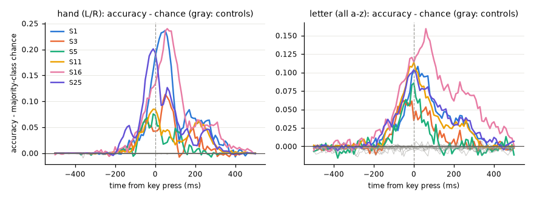
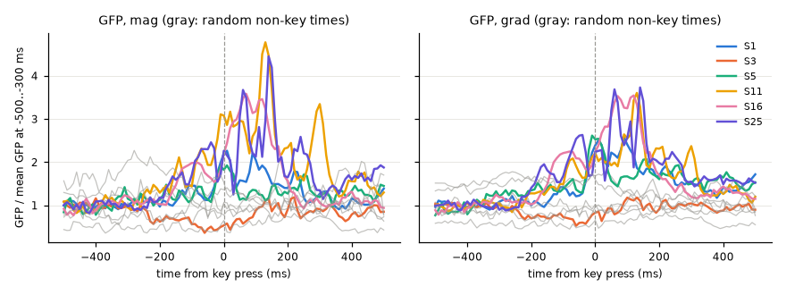

# M1 sanity check: is there keystroke signal in the cache?

The M1-B decoder does not use the MEG: its test CER (0.670) is equal to the shuffled-MEG control (0.669) ([M1-B results](../2026-11-08-m1b-decoder/results.md)). This check asks if the cause is the data. If the preprocessing cache or the key alignment is wrong, a simple linear model cannot find keystroke signal either.

**Verdict A: the signal is present.** A linear classifier decodes the hand (left/right) at 0.83–0.96 and the letter at 0.31–0.49 (chance about 0.14) in every subject. Both controls stay at chance. The accuracy peaks between −10 and +60 ms around the key press. The cache and the alignment are correct. The CTC failure comes from the data volume or the model, not from the data.

- Code: `run.py` (decoding), `plot.py` (figures). Read-only on the cache. numpy only, RAM < about 2 GB.
- Raw numbers: `results/decoding.json` (curves per subject and task). Log: `results/run_log.txt`.
- Figures: `results/decoding_curves.png`, `results/evoked_gfp.png`.

## Method

| Item | Value |
|---|---|
| Data | SpanishBCBL cache v1 (tSSS, 0.5–45 Hz, 100 Hz). The 6 subjects with cached blocks at run time: S1, S3, S5, S11, S16, S25. |
| Events | Letter key presses only. |
| Epochs | −0.5 to +0.5 s around each key press (101 samples at 100 Hz), 306 channels. |
| Classifier | Ridge classifier in numpy (no sklearn). Alpha from 13 values (10⁻¹ to 10⁵), chosen by efficient leave-one-out on the training fold. |
| Cross-validation | 5 folds, grouped by trial: all keys of one sentence are in the same fold. |
| Time-resolved | One classifier per time sample (306 features). The "peak" is the best time sample. |
| Window | One classifier on −0.2..+0.3 s, in 50 ms bins (306 × 10 features). |
| Task: hand | Left vs right hand, QWERTY layout (`qwertasdfgzxcvb` = left, `yuiophjklnm` = right). The majority class is about 0.60. |
| Task: letter | Letter identity, a–z (24–25 classes per subject: the letters in the data). |
| Control (a) | The same epochs with shuffled labels. |
| Control (b) | Random times at least 0.25 s from any key press, with the real labels of the key presses. |
| Evoked | Global field power (GFP) of the key-press average, for magnetometers and gradiometers separately. Also for the random times. |

Chance = the majority-class rate of each task.

## Results

| Subject | Keys | Hand peak (time) | Hand window −0.2..+0.3 | Letter peak | Letter window | Chance hand / letter |
|---|---|---|---|---|---|---|
| S1 | 4917 | 0.836 (+50 ms) | 0.931 | 0.245 | 0.399 | 0.60 / 0.137 |
| S3 | 2252 | 0.718 (+50 ms) | 0.875 | 0.206 | 0.306 | 0.60 / 0.144 |
| S5 | 1892 | 0.674 (−10 ms) | 0.832 | 0.218 | 0.313 | 0.60 / 0.133 |
| S11 | 4817 | 0.689 (−10 ms) | 0.842 | 0.252 | 0.335 | 0.60 / 0.138 |
| S16 | 2442 | 0.843 (+60 ms) | 0.957 | 0.296 | 0.492 | 0.60 / 0.136 |
| S25 | 8769 | 0.801 (−10 ms) | 0.934 | 0.239 | 0.437 | 0.60 / 0.135 |



### Controls
- Both controls are at chance for every subject.
- Hand: the controls give exactly the majority rate (window 0.597–0.604).
- Letter: the controls give 0.12–0.15.
- Thus the classifier does not exploit a label imbalance or a leak between folds. The signal is locked to the key press.

### Timing
- The peaks fall between −10 and +60 ms around the key press.
- Before −300 ms, the accuracy is at chance.
- Comparison: the Brain2Qwerty v1 linear hand decoder peaked at 74 % at +40 ms ([v1](../../wiki/sources/brain2qwerty-v1.md), key results; MEG). Our peaks (0.67–0.84) are in the same range, at about the same time.

### Evoked response (GFP)
- Near the key press, the GFP is 2–4.5× above the baseline, for mag and grad.
- At the random times, the GFP is flat.



## Notes per subject
- **S3:** its GFP falls below the baseline. A possible cause: its key presses come very close together, so the baseline window already holds evoked activity. We did not check this. The decoding of S3 is still clearly above chance.
- **S5 and S11** are weaker (hand window 0.83–0.84). S5 has 16 bad channels.
- **S16** has 29 bad channels, but it is still the best subject.

## What this means for M1
- The cache (tSSS, filter, resampling) keeps the keystroke signal.
- The key alignment is correct: the peaks are at the key press, not shifted.
- Thus the M1-B failure (CER equal to the shuffled-MEG control) comes from the data volume or the model. Next: more subjects (full cache), low-data tuning, and a keystroke auxiliary loss for the CTC decoder.

## Not done
- The `--raw-check` mode (compare the cache with the raw .fif, S25 ses1 block1, first 300 s) was not run. With verdict A, it has low priority.

## Reproduce

```bash
C:\Venvs\fidetype-rocm\Scripts\python.exe experiments/2026-11-08-m1-sanity/run.py
C:\Venvs\fidetype-rocm\Scripts\python.exe experiments/2026-11-08-m1-sanity/plot.py
```

The run takes about 37 min (6 subjects, one process).
