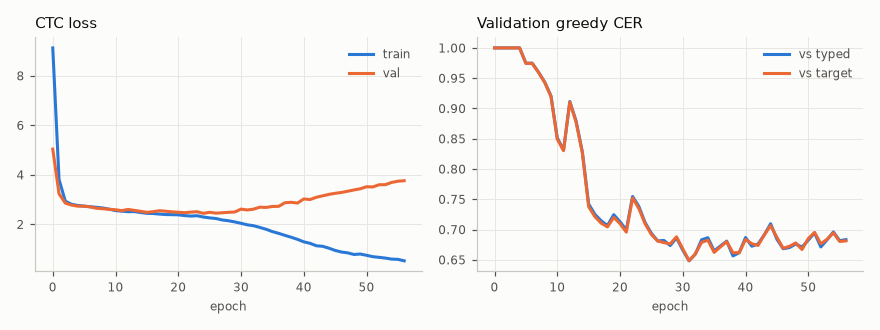
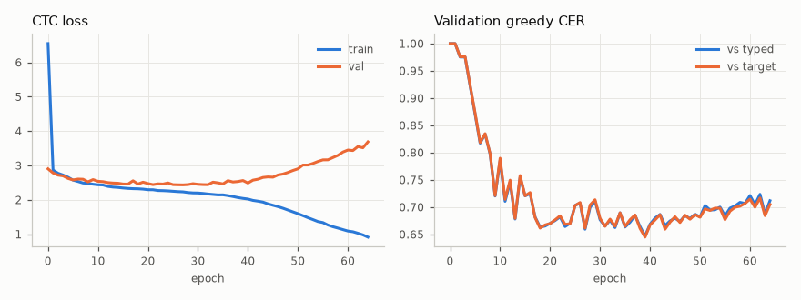

# M1-B: baseline brain-to-text decoder (ConvCTC)

Milestone M1-B. We train our own conv + Conformer + CTC model. It decodes typed text from continuous MEG. It writes NeuralTextStream v0.1 files.

**Status:** the pipeline works end to end. With the data that is cached now, the model does **not** decode MEG to unseen sentences.

- Best test greedy CER is 0.670 (5 subjects, 477 training sentences).
- The same model gets the same CER (0.669) when it gets the MEG of another trial. Thus the CER comes from a text prior, not from the MEG.
- The M1 target (greedy CER near 0.59, v2 async encoder on SpanishBCBL) is **not met**. The main cause is the amount of data (about 2.5 h, versus the full dataset). See "Next steps".

## Code

| File | Job |
|---|---|
| `src/fidetype/decoders/dataset.py` | Torch dataset over the cache. Memory-maps each block. Excludes practice trials. Has the augmentations, collate and a seeded bucket sampler. |
| `src/fidetype/decoders/conv_ctc.py` | The model. Offline and causal modes. Param-count report. |
| `src/fidetype/decoders/train.py` | Training CLI: AdamW, warmup + cosine, bf16, grad clip, checkpoints, resume, early stop, logs. |
| `src/fidetype/decoders/infer.py` | Checkpoint -> NeuralTextStreams + `labels.jsonl` + CER/WER. |
| `src/fidetype/decoders/synthetic.py` | Synthetic cache in the real format, for tests. |
| `tests/test_decoders.py` | 14 tests. They skip without torch. |
| `experiments/2026-11-08-m1b-decoder/launch.ps1` | Starts a detached, hidden training process. |
| `experiments/2026-11-08-m1b-decoder/plot_curves.py` | Training-curve PNG from `metrics.jsonl`. |

Configs in this folder: `config-synthetic.json`, `config-real.json` (all cached subjects), `config-real-1subj.json` (S25), `config-real-1subj-small.json` (S25, small model), `config-real-multi.json` (multi-subject run).

## Architecture

The design follows the v2 "Encoder Async" ([v2](../../wiki/sources/brain2qwerty-v2.md), [BrainModule](../../wiki/concepts/brainmodule.md), [CTC](../../wiki/concepts/ctc.md)). It is about 10 M parameters, not hundreds of millions. The code is our own.

| Stage | Setting (default config) | Parameters |
|---|---|---|
| Spatial 1x1 conv | 306 -> 256 | 78,592 |
| Subject affine layer | one 256x256 matrix + bias per participant (identity init) | 65,792 per subject |
| Dilated residual conv stack | 5 blocks, width 320, kernel 5, dilation 1-2-4-8-16, LayerNorm, GELU, dropout | 3,160,640 |
| Strided conv | kernel 8, stride 4: 100 Hz -> 25 Hz (40 ms frames) | 656,768 |
| Aux CTC head + self-conditioning | 28 classes; softmax fed back through a linear layer | 14,620 |
| Conformer | 4 layers, d = 256, 4 heads, FFN 1024, depthwise kernel 15 (own code) | 6,075,392 |
| Final CTC head | 28 classes | 7,196 |
| **Total (1 subject)** | | **10,059,000** |

- Loss = 0.3 x CTC(final) + 0.7 x CTC(aux), as in v2.
- LayerNorm (per time step) is used everywhere instead of BatchNorm. The model has no statistics across time.
- **Causal mode:** set `lookahead_frames` to an int. All convolutions then pad on the left. Each attention layer lets frame i see frames j <= i + lookahead. The total lookahead is `conformer_layers x lookahead_frames` frames. The tests check this: a change to the input after the lookahead does not change earlier outputs. The default is offline (`null`).
- We wrote our own Conformer block. `torchaudio.models.Conformer` runs on ROCm, but it does not take an attention mask, and its depthwise conv is not causal.

## Data

Cache: `C:\Users\zhang\bci-data\cache\spanishbcbl\v1\` (made by M1-A). The split comes from a hash of the target text. Practice trials (`is_training`) are excluded.

| Run | Subjects | Blocks | Train | Val | Test |
|---|---|---|---|---|---|
| `m1-baseline-2026-11-08-1subj` | S25 | 4 | 202 | 22 | 32 |
| `m1-baseline-2026-11-08-5subj` | S1, S3, S5, S11, S25 | 10 (S25: 4, S1: 2, S11: 2, S3: 1, S5: 1) | 477 | 56 | 100 |

A segment is 3.5 to 7.6 s long (median 5.5 s) and has a median of 32 characters. Typing is fast (about 6 characters per second), so there are about 4 frames per character.

## Results

### Synthetic smoke run (`m1b-synthetic-smoke`)

Synthetic cache: 4 subjects x 4 blocks x 30 trials, a weak per-key signal (amplitude 1.0). This proves the pipeline only.

| Split | n | CER (target) | WER (target) |
|---|---|---|---|
| val | 46 | 0.691 | 0.983 |
| test | 41 | 0.706 | 0.979 |

40 epochs, 6 s/epoch, 2.0 GB peak GPU memory. Curves: `results/m1b-synthetic-smoke-curves.png`.

### Real data, S25 only (`m1-baseline-2026-11-08-1subj`)



Early stop at epoch 57. The best val CER is at epoch 31. After epoch 30 the val loss goes up: the model overfits.

Greedy CTC, best checkpoint (epoch 31), mean over subjects (1 subject here):

| Split | n | CER target | CER typed | WER target | WER typed |
|---|---|---|---|---|---|
| val | 22 | 0.648 | 0.648 | 0.980 | 0.971 |
| test | 32 | **0.707** | 0.709 | 0.966 | 0.966 |

Per-sentence CER (target), test: p10 0.646, median 0.709, p90 0.769. No sentence is decoded without error.

**Control: does the model use the MEG?** We give the best model three inputs. "Shuffled" is the MEG of another trial of the same split. CER is against the typed text.

| Model | Split | Real MEG | Shuffled MEG | Zeros |
|---|---|---|---|---|
| default (10.1 M) | train | 0.557 | 0.677 | 0.839 |
| default (10.1 M) | val | 0.648 | 0.688 | 0.843 |
| default (10.1 M) | test | 0.709 | 0.711 | 0.854 |
| small (3.3 M, dropout 0.3) | train | 0.363 | 0.689 | 0.895 |
| small (3.3 M, dropout 0.3) | val | 0.666 | 0.694 | 0.902 |
| small (3.3 M, dropout 0.3) | test | 0.702 | 0.697 | 0.895 |

> **Our take:** On test, real MEG and shuffled MEG give the same CER. The model learned a Spanish letter prior and the segment length, not a MEG-to-key mapping that generalises. On train, the gap is large (the model memorises). A CER of about 0.70 is the "text prior" floor for this data. Any future claim must beat the shuffled-MEG control, not only CER 1.0.

Example decodes (test, S25, sorted by CER, target | greedy output):

| CER | Target | Greedy CTC |
|---|---|---|
| 0.58 | las funciones leen los archivos | las as cioieia elas eas |
| 0.66 | las agencias disponen los equipos por la manana | las aeaos ii a eros as |
| 0.70 | los productos cumplen la propiedad asociada | las  ioaacio la  las nas |
| 0.72 | las versiones del programa soportan el comando | las ta la aoas lo ls as |
| 0.74 | el cliente establece la conexion creada | las ocici ien las  eioes |

The output is high-frequency Spanish letters (a, s, l, e, i, o) and spaces. This is the text prior.

### Multi-subject run

Run `m1-baseline-2026-11-08-5subj`: all blocks that were cached at 14:20 (5 subjects, 10 blocks, about 2.5 h of MEG). Config: `config-real-multi.json` (the default model, 10.3 M parameters with 5 subject layers). Early stop at epoch 65 (14:24). The best val CER is at epoch 39. 3.3 s per epoch, 1.74 GB peak GPU memory.



Greedy CTC, best checkpoint, mean over subjects:

| Split | n | CER target | CER typed | WER target | WER typed |
|---|---|---|---|---|---|
| val | 56 | 0.645 | 0.647 | 1.058 | 1.054 |
| test | 100 | **0.670** | 0.675 | 1.043 | 1.068 |

Per-sentence CER (target), test: p10 0.609, median 0.675, p90 0.717. WER is above 1 because the model emits more "words" than the target has.

Per subject (test, CER target): S1 0.682 (n = 27), S11 0.673 (26), S25 0.661 (32), S3 0.675 (12), S5 0.662 (3).

MEG control (`infer.py --control`, CER target):

| Split | Real MEG | Shuffled MEG | Zeros |
|---|---|---|---|
| val | 0.643 | 0.662 | 0.863 |
| test | 0.671 | 0.669 | 0.858 |

> **Our take:** 5 subjects do not change the conclusion. Test CER with real MEG equals test CER with the MEG of another trial. The 0.04 gain over the S25-only run (0.707 -> 0.670) comes from a better text prior (more sentences), not from the MEG. The model has about 0.5 h of MEG for each subject, and v2 needed far more. The data is still too small.

Example decodes (test, sorted by CER, target | greedy output):

| CER | Subject | Target | Greedy CTC |
|---|---|---|---|
| 0.55 | S1 | la revolucion nueva abarca las esferas | la enaecio a eas ean la ceios |
| 0.64 | S1 | el cliente establece la conexion creada | las enelas ceda las centa las ceas |
| 0.67 | S1 | los grupos del organismo exigen la liberacion | las enos cealas ceos a las cela as |
| 0.69 | S11 | los grupos del organismo exigen la liberacion | las enaaase las ceoa las ceeas |
| 0.71 | S11 | los grupos del organismo exigen la liberacion | la enas ceaea las cenoas eiaas |

## GPU memory and speed (RX 7800 XT, ROCm 7.2.1, bf16)

| Item | Value |
|---|---|
| Peak memory, batch 16, segments 3.5-7.6 s | 1.07 GB (1 subject), 1.74 GB (5 subjects) |
| Training step (B = 16, T = 400-800, 10 M params) | about 80 ms with an idle CPU |
| Epoch, S25 (13 steps + val) | 1.2 s |
| Epoch, 5 subjects (30 steps + val) | 3.3 s |
| Epoch, synthetic (23 steps of 10-15 s segments + val) | 5-6 s |

**ROCm problems we found and fixed:**
1. MIOpen searches convolution kernels for every new input shape. With variable segment lengths, the first run spent minutes per batch. Fixes: `MIOPEN_FIND_MODE=FAST` (set in `train.py` and `infer.py`), and lengths padded to a multiple of 100 samples (`data.pad_multiple`). The model masks the padding, so the outputs do not change (`test_batch_matches_single`).
2. GPU speed falls by 10x or more when the CPU is at 100%, because kernel dispatch needs CPU. M1-A's preprocessing uses most of the 16 threads. `train.torch_threads = 4` limits our CPU use.
3. `conv_ctc.CONV_IMPL` can be `"gemm"` (convolution as unfold + matmul, without MIOpen). It gives the same result. The speed is the same, and it uses about 70% more memory, so the default stays `"native"`. Use `FIDETYPE_CONV_IMPL=gemm` if MIOpen causes problems.

## Commands

Launch (detached, hidden window; it outlives the session):

```powershell
.\experiments\2026-11-08-m1b-decoder\launch.ps1 -Config experiments\2026-11-08-m1b-decoder\config-real.json -RunName <run_name>
```

Check:

```powershell
Get-Content C:\Users\zhang\bci-data\runs\<run_name>\status.json
Get-Content C:\Users\zhang\bci-data\runs\<run_name>\train.log -Tail 5
Get-Process -Id (Get-Content C:\Users\zhang\bci-data\runs\<run_name>\pid.txt)
```

Stop: `Stop-Process -Id (Get-Content C:\Users\zhang\bci-data\runs\<run_name>\pid.txt)`. The last checkpoint is at most 5 minutes old, and every epoch end also writes one.

Resume: `.\experiments\2026-11-08-m1b-decoder\launch.ps1 -RunName <run_name> -Resume`

Inference and metrics (GPU env):

```bash
C:/venvs/fidetype-rocm/Scripts/python.exe -m fidetype.decoders.infer --run-dir C:/Users/zhang/bci-data/runs/<run_name>
```

This writes `C:\Users\zhang\bci-data\streams\<run_name>\{val,test}\*.npz`, `labels.jsonl`, `metrics.json` and `per_sentence_<split>.jsonl`.

Plot: `python experiments/2026-11-08-m1b-decoder/plot_curves.py C:/Users/zhang/bci-data/runs/<run_name> experiments/2026-11-08-m1b-decoder/results/<run_name>-curves.png`

## Next steps

1. **More data.** This is the main lever. v2 shows CER is log-linear in hours ([v2](../../wiki/sources/brain2qwerty-v2.md), Fig. 1F). Train on all subjects when M1-A's cache is complete (`config-real.json`, subjects `null`). Pin the subject list in the config for each run.
2. **Always report the shuffled-MEG control** next to CER (`infer.py --control`). A CER is only evidence of decoding if "real" is clearly below "shuffled".
3. **Hyperparameters for low data:** a smaller model, stronger dropout, more time masking, and fewer Conformer layers. With 1 subject, both model sizes overfit in under 40 epochs.
4. **Cross-subject pretraining** (joint training was best in v2, Table 1), then a per-subject fine-tune.
5. **Labels:** we train on `typed_text`. Check the CER against `target_text` too (the two are almost the same here).
6. **Causal mode:** train with `lookahead_frames` = 0 to 3 for M4, and compare with offline.
