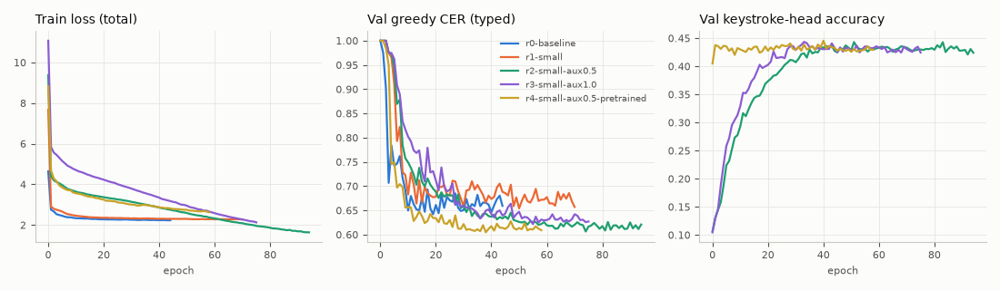

# M1-C: keystroke auxiliary loss

M1-B showed that the ConvCTC decoder does not use the MEG: CER with real MEG equals CER with the MEG of another trial ([M1-B](../2026-11-08-m1b-decoder/results.md)). The M1 sanity check showed linear letter signal per keystroke ([M1 sanity](../2026-11-08-m1-sanity/results/run_log.txt)). M1-C adds a direct per-keystroke loss. The question: does the decoder then use the MEG?

**Answer: yes.** With the keystroke loss, real MEG gives a test CER 0.12 to 0.16 lower than shuffled MEG. The 95% CI excludes zero. Without the loss, on the same data and the same model, the gap is zero.

| Run | Keystroke loss | Test CER (target) | Shuffled-MEG CER | Gap [95% CI] |
|---|---|---|---|---|
| r0 baseline (10.7 M, M1-B config) | no | 0.670 | 0.669 | -0.001 [-0.006, +0.004] |
| r1 small (3.5 M) | no | 0.684 | 0.681 | -0.002 [-0.008, +0.003] |
| r2 small, weight 0.5 | yes | 0.628 | 0.744 | **+0.116** [+0.103, +0.130] |
| r3 small, weight 1.0 | yes | 0.639 | 0.754 | **+0.116** [+0.102, +0.129] |
| r4b small, weight 0.5, keystroke-pretrained | yes | **0.619** | 0.776 | **+0.156** [+0.141, +0.172] |

CER here is the mean over sentences, greedy CTC, best checkpoint by val CER. The M1 target (greedy CER near 0.59) is still not met. The best test CER is 0.619 (mean over subjects 0.624).

## Method

- **Loss.** A keystroke at sample `s` (100 Hz, relative to the segment start) maps to encoder frame `s // 4` (40 ms frames). A linear head (27 classes: a-z and space) reads the frame features. The features are mean-pooled over frames `f + 1 + (-1..+1)`: the read-out is shifted 1 frame (40 ms) after the key, because the response peaks after the key press. Keys outside the 27 classes (return, unknown) are ignored.
- **Heads.** `aux_key_layer = "both"`: one head on the conv-stack frames (before the aux CTC head) and one on the Conformer output. The keystroke loss is the mean of the two cross-entropies.
- **Total loss.** `ctc_weight x (0.3 CTC_final + 0.7 CTC_aux) + aux_keystroke_weight x CE_keys`.
- **Inference.** The keystroke heads are not used for decoding. They do not change the CTC logits (tested).
- **Pretraining (r4).** r4a trains with `ctc_weight = 0` (keystroke loss only) and early-stops on val keystroke error. r4b starts from r4a's weights (`train.init_from`) and trains with CTC + 0.5 x keystroke loss.
- **Control.** `infer.py --control` decodes each segment with its own MEG, with the MEG of another segment of the same split, and with zeros. The new gap CI is a paired bootstrap over sentences (10,000 resamples) of "shuffled CER - real CER". The keystroke heads are also scored on shuffled MEG, read at the true key times.

## Data (pinned)

All configs pin the 20 blocks that were cached at 15:10 (`data.blocks`). The cache still grows, so a later run with the same config uses the same data.

| Item | Value |
|---|---|
| Subjects | S1, S3, S5, S9, S11, S12, S15, S16, S18, S19, S25 |
| Participants (subject layers) | 10. S18 and S1 are both P01 in the index. |
| Segments train / val / test | 947 / 114 / 209 |
| Keystrokes train / val / test | 39,290 / 4,981 / 8,656 (val/test labelled: 4,855 / 8,423) |

This is about twice the M1-B 5-subject data (477 train segments).

> **Our take:** S1 and S18 map to the same participant (P01). This can be one person recorded twice, or an index error from M1-A. Check it before any per-participant claim.
>
> **Resolved (2026-11-08):** one person, recorded twice (dataset card; recording code 9228 for both). No leakage: splits are by sentence. Test mean CER over 10 participants: r0 0.669, r1 0.681, r2 0.634, r3 0.646, r4b 0.621. See [SpanishBCBL repeated participants](../../wiki/questions/spanishbcbl-repeated-participants.md).

## Models

| Config | Model | Augment | Optim |
|---|---|---|---|
| r0 | M1-B default: 4 Conformer layers, d 256, conv 320 x 5, dropout 0.2 (10.65 M with 10 subject layers) | M1-B | lr 5e-4, wd 0.05 |
| r1-r4 | small: spatial 128, conv 256 x 4, d 192, 2 Conformer layers, FFN 512, dropout 0.35, input dropout 0.1 (3.54 M; + 10.4 k for the key heads) | 4 time masks of up to 0.4 s, 2 channel masks of up to 60 | lr 3e-4, warmup 800, wd 0.1 |

All runs: batch 16, bf16, early stop on val CER (typed), patience 25 (r0) or 20, max 30 min. Each run took 5 to 11 min on the RX 7800 XT (60 steps per epoch, about 6 s per epoch with val).

## Full results

Mean over sentences. Key acc = keystroke-head accuracy at the true key times, with real MEG / shuffled MEG, for the conv head and the Conformer head. The majority-class accuracy is 0.129 (val) and 0.132 (test).

| Run | Params | Epochs (best) | Split | CER tgt real | Shuffled | Zeros | Gap [95% CI] | CER typed | WER tgt | Key acc real / shuf (conv, conformer) |
|---|---|---|---|---|---|---|---|---|---|---|
| r0-baseline | 10.65M | 45 (19) | val | 0.641 | 0.641 | 0.848 | +0.001 [-0.006, +0.007] | 0.642 | 1.030 | - |
| r0-baseline | 10.65M | 45 (19) | test | 0.670 | 0.669 | 0.851 | -0.001 [-0.006, +0.004] | 0.668 | 1.046 | - |
| r1-small | 3.54M | 71 (50) | val | 0.648 | 0.650 | 0.819 | +0.002 [-0.005, +0.009] | 0.653 | 1.248 | - |
| r1-small | 3.54M | 71 (50) | test | 0.684 | 0.681 | 0.833 | -0.002 [-0.008, +0.003] | 0.683 | 1.268 | - |
| r2-small-aux0.5 | 3.55M | 95 (74) | val | 0.601 | 0.737 | 0.905 | +0.136 [+0.116, +0.157] | 0.599 | 0.893 | 0.396/0.091, 0.430/0.101 |
| r2-small-aux0.5 | 3.55M | 95 (74) | test | 0.628 | 0.744 | 0.906 | +0.116 [+0.103, +0.130] | 0.625 | 0.921 | 0.378/0.099, 0.415/0.107 |
| r3-small-aux1.0 | 3.55M | 76 (55) | val | 0.619 | 0.747 | 0.877 | +0.128 [+0.110, +0.146] | 0.616 | 0.924 | 0.411/0.095, 0.436/0.106 |
| r3-small-aux1.0 | 3.55M | 76 (55) | test | 0.639 | 0.754 | 0.880 | +0.116 [+0.102, +0.129] | 0.635 | 0.926 | 0.389/0.092, 0.418/0.107 |
| r4a-pretrain-keys | 3.55M | 49 (33) | test | (CTC head not trained) | | | | | | 0.392/0.101, 0.408/0.100 |
| r4b-aux0.5-pretrained | 3.55M | 59 (38) | val | 0.605 | 0.776 | 1.000 | +0.171 [+0.150, +0.191] | 0.599 | 0.893 | 0.411/0.090, 0.439/0.101 |
| r4b-aux0.5-pretrained | 3.55M | 59 (38) | test | 0.619 | 0.776 | 1.000 | +0.156 [+0.141, +0.172] | 0.618 | 0.915 | 0.377/0.097, 0.411/0.107 |

Mean over subjects, test CER target: r0 0.669, r1 0.682, r2 0.635, r3 0.648, r4b 0.624.



### Example decodes (test, best and median by CER)

| Run | CER | Subject | Target | Greedy CTC |
|---|---|---|---|---|
| r0 | 0.52 | S3 | las funciones leen los archivos | las enas ea las ceos |
| r0 | 0.67 | S1 | el cuaderno presenta las divisiones enteras | las enos e las e las e las eos |
| r2 | 0.29 | S25 | las funciones leen los archivos | las suciones e los aciaios |
| r2 | 0.64 | S3 | las agencias disponen los equipos por la manana | los uan las esios bonmes o rconas as |
| r4b | 0.33 | S15 | el cuaderno presenta las divisiones enteras | el cuaer preta las daicioos eitrs |
| r4b | 0.63 | S25 | el cuaderno presenta las divisiones enteras | el osuampee de lrenaciins voas |

More examples: `results/table.md` (made by `summarize.py`).

## Interpretation

> **Our take:** The keystroke loss is the cause of the MEG use. r1 and r2 have the same model, data, augmentation and optimiser. Only the loss differs. r1 has a zero gap, r2 a gap of +0.116. Twice the data alone (r0, r1) does not help.

> **Our take:** The keystroke heads read 38-44% of keystrokes correctly from real MEG (chance by majority class: 13%). With shuffled MEG they read 9-11%. Thus the heads read per-key MEG signal, not the text prior. This is close to the M1 sanity linear "window" classifier (letter accuracy 0.31-0.49 per subject).

> **Our take:** The CER gain is smaller than the gap. Shuffled-MEG CER goes up (0.68 to 0.74-0.78), because the model now depends on the MEG. Real-MEG CER goes down only 0.04-0.06 (r0 0.670 to r4b 0.619). The decodes now show word starts and consonants ("el cuaer preta las daicioos"), not only "las ... as".

> **Our take:** Weight 0.5 is slightly better than 1.0 (test CER 0.628 vs 0.639; the same gap). Keystroke pretraining (r4b) gives the best CER (0.619) and the largest gap (+0.156), and it converges in fewer epochs. Each comparison is one seed, so differences of about 0.01 are within noise.

> **Our take:** In r4b, zeros give CER 1.000: the model emits nothing without MEG. In r0, zeros give 0.85 (the text prior).

## Code changes

| File | Change |
|---|---|
| `src/fidetype/decoders/dataset.py` | Items have `key_pos` (moved with start jitter and time stretch) and `key_label` (27 classes, -100 = ignore). `collate` pads them (`key_samples`, `key_labels`, `key_mask`). New `blocks` filter (pins a run to fixed blocks). |
| `src/fidetype/decoders/conv_ctc.py` | `aux_keystroke_weight`, `aux_key_layer`, `aux_key_pool`, `aux_key_shift_frames`, `ctc_weight`. `key_frames()`, `key_logits()`, keystroke CE in `loss()`. Weight 0 builds no extra modules: same parameters, same initial values, same loss (tested). |
| `src/fidetype/decoders/train.py` | Passes the keys to the loss; logs train/val keystroke CE and accuracy. `data.blocks`, `train.init_from`, early stop on `val_key_err`. `hard_exit()` (see below). |
| `src/fidetype/decoders/infer.py` | `keystroke_head` accuracy per split; key accuracy per control input; `meg_control_gap` (paired bootstrap CI); `control_per_sentence_<split>.json`. |
| `tests/test_decoders.py` | 8 new tests (23 in total): frame mapping and clamping, key positions under augmentation, collate padding, block filter, loss shapes and value for each layer, weight 0 equals the old model, tiny overfit with the keystroke loss, init_from + inference with control. |

**Process-exit hang fixed.** On ROCm/Windows, a process that ran MIOpen convolutions does not end after `sys.exit` or `os._exit`. It spins one CPU core forever. The 4 M1-B training processes (finished at 13:45 to 14:24) were still alive at 15:10, each with one core and about 3.6 GB. `train.hard_exit()` calls `TerminateProcess`, which skips the HIP DLL-detach code. All 12 M1-C train and infer processes ended normally.

> **Open item:** the 4 hung M1-B processes (python PIDs 25972, 34088, 49196, 16144, and their venv launcher PIDs 552, 14012, 35088, 40980) were still running when M1-C ended. The agent was not permitted to stop them. Stop them by hand: `Stop-Process -Id 25972,34088,49196,16144,552,14012,35088,40980`.

## Commands

Run the queue (detached; restart-safe, it skips finished runs and resumes the rest):

```powershell
Start-Process powershell -WindowStyle Hidden -ArgumentList '-NoProfile','-ExecutionPolicy','Bypass','-File','experiments\2026-11-08-m1c-decoder-aux\run_queue.ps1','-Runs','r2-small-aux0.5,r1-small'
Get-Content C:\Users\zhang\bci-data\runs\m1c-queue.log -Tail 5
```

Stop: `Stop-Process -Id (Get-Content C:\Users\zhang\bci-data\runs\m1c-queue.pid)`, then stop the python child.

Table and plot (GPU env):

```bash
python experiments/2026-11-08-m1c-decoder-aux/summarize.py m1c-r0-baseline m1c-r1-small m1c-r2-small-aux0.5 m1c-r3-small-aux1.0 m1c-r4-pretrain-keys m1c-r4-small-aux0.5-pretrained > experiments/2026-11-08-m1c-decoder-aux/results/table.md
python experiments/2026-11-08-m1c-decoder-aux/plot_curves.py experiments/2026-11-08-m1c-decoder-aux/results/curves.png C:/Users/zhang/bci-data/runs/m1c-r{0-baseline,1-small,2-small-aux0.5,3-small-aux1.0,4-small-aux0.5-pretrained}
```

Outputs: runs in `C:\Users\zhang\bci-data\runs\m1c-*`, streams and metrics in `C:\Users\zhang\bci-data\streams\m1c-*`. The infer logs are UTF-16 (PowerShell redirect).

## Next steps

1. **Seeds.** Run r1, r2 and r4b with 3 seeds each to measure the variance (about 10 min per run).
2. **Beam + char LM on the new streams.** r4b streams carry MEG information. The beam (`experiments/2026-11-08-beam-retune`) may now help more than on M1-B streams.
3. **Full cache.** Re-run r4a/r4b when M1-A ends (47 blocks). Pin the new block list.
4. **Read-out shift and pooling.** Only shift 1 and pool 1 were tried on real data. The M1 sanity peaks are at -10 to +60 ms.
5. **Check S1/S18 = P01.**
