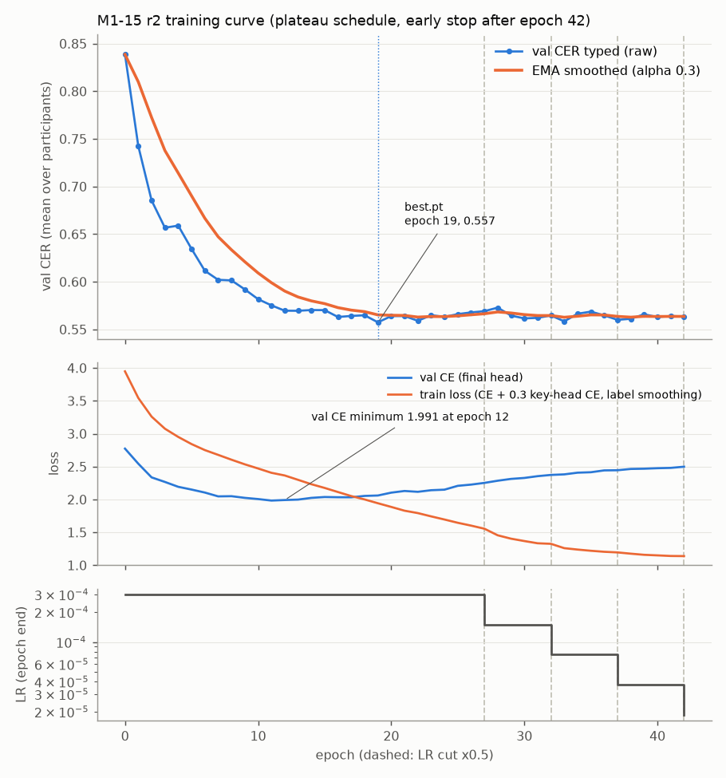

# M1-15: sentence-context keystroke decoder

**r2 (2026-11-10) is the current result.** See [r2 results](#r2-results-2026-11-10) first. The r1 text below the r2 section is kept as it was.

## r2 results (2026-11-10)

**Answer (r2): yes, a small gain.** r2 trained to the end of the val trend (43 epochs, 13.0 min of active compute). It is the first decoder of this project that beats the like-for-like M2-10 logistic regression on test:

- Test greedy CER vs target **0.577** (M2-10: 0.597; r1: 0.619).
- Test beam + LM CER vs target **0.488** (M2-10: 0.531; r1: 0.532).
- It uses the MEG: shuffled − real gap **+0.214** [+0.200, +0.228] greedy, **+0.258** [+0.238, +0.278] beam + LM (CIs exclude 0).
- The Transformer (sentence context) adds only **0.025** greedy CER over the Conv-only head (0.602 → 0.577). v1 had 0.67 → 0.36.
- The model overfits after epoch 12 to 19. Val CER stays flat; val cross-entropy rises. The trend stop fired correctly.
- Trust harness (eWPM): trust 3.06, always commit 2.49, gaze typing only 3.14. Still no BCI gain over the no-BCI baseline.

Files: `results/metrics-r2.json` (final head), `results/metrics-r2-head-conv.json` (Conv-only head), `results/train_curve-r2.json` (per-eval values parsed from `train.log` plus val CE from `metrics.jsonl`), `results/train_curve-r2.png`, `results/train_log-r2.txt`, `results/infer_log-r2.txt`, `results/infer_log-r2-head-conv.txt`, `results/ewpm-r2/real.json`. Checkpoints and streams stay outside the repo: `C:\Users\zhang\bci-data\runs\m1-15-sentence-context-r2\`, `C:\Users\zhang\bci-data\streams\m1-15-sentence-context-r2\` and `...\m1-15-sentence-context-r2_head-conv\`.

### r2 set-up (differences from r1)
| Item | r2 value |
|---|---|
| Config | [config-r2.json](config-r2.json): r1 model and data (same 20 pinned blocks, 11 subject IDs, 10 participants, 947 / 114 / 209 sentences). Code `6132c60`. |
| Schedule | `optim.schedule: "plateau"`: warm-up 300 steps, constant lr 3e-4, x0.5 after `plateau_patience` 5 evals with no gain of the EMA val CER (`smooth_alpha` 0.3, `min_delta` 0.002), floor 1e-5. Stop when 20 evals show no gain AND (LR at floor OR ≥ 3 LR cuts). `epochs` 2000 (no real limit), `max_minutes` 300 (active time). |
| Run | Queue `queue-2026-11-10`. Training 19:16:29–19:29:29 (13.0 active min = wall clock). `keep_awake=on`. No "suspend gap detected" line. Stop after the epoch-42 eval (the log says "epoch 43", the next epoch index). `best.pt` = epoch 19 (best raw val CER typed 0.5574, mean over participants). |
| Inference | Same as r1 (`--control --lm spa_tatoeba_6gram_mkn.npz --lm-weights 0.25 0.5 1.0 1.25 2.0`), once with `--head final` (19:30–19:34) and once with `--head conv` (19:34–19:38). Both from `best.pt`. Exit 0. AC sleep restored to 30 min at 19:38:47. |

### r2 test (209 sentences), CER vs target
| head | decoder | input | mean over sentences | mean over participants | CER vs typed (sentences) |
|---|---|---|---|---|---|
| Conv + Trans (final) | greedy | real MEG | **0.577** | 0.577 | 0.569 |
| Conv + Trans (final) | greedy | shuffled MEG | 0.791 | 0.788 | 0.791 |
| Conv + Trans (final) | greedy | zeros | 0.841 | 0.842 | 0.838 |
| Conv + Trans (final) | beam + LM (w 1.25) | real MEG | **0.488** | 0.493 | 0.482 |
| Conv + Trans (final) | beam + LM (w 1.25) | shuffled MEG | 0.746 | 0.743 | 0.748 |
| Conv + Trans (final) | beam + LM (w 1.25) | zeros | 0.750 | 0.747 | 0.749 |
| Conv only | greedy | real MEG | **0.602** | 0.605 | 0.592 |
| Conv only | greedy | shuffled MEG | 0.807 | 0.805 | 0.808 |
| Conv only | greedy | zeros | 0.901 | 0.902 | 0.892 |
| Conv only | beam + LM (w 1.0) | real MEG | **0.503** | 0.500 | 0.495 |
| Conv only | beam + LM (w 1.0) | shuffled MEG | 0.763 | 0.759 | 0.763 |
| Conv only | beam + LM (w 1.0) | zeros | 0.775 | 0.771 | 0.774 |

Gap shuffled − real (test, paired bootstrap over sentences, 10,000 resamples, CER vs target; no resample ≤ 0 in any row):

| head | greedy | beam + LM |
|---|---|---|
| Conv + Trans | +0.214 [+0.200, +0.228] | +0.258 [+0.238, +0.278] |
| Conv only | +0.205 [+0.189, +0.221] | +0.259 [+0.240, +0.280] |

No test sentence has CER 0 with either head.

### r2 val (114 sentences), CER vs target
| head | decoder | real (sentences / participants) | shuffled | zeros | gap shuffled − real [95 % CI] |
|---|---|---|---|---|---|
| Conv + Trans | greedy | 0.560 / 0.572 | 0.768 | 0.822 | +0.208 [+0.183, +0.232] |
| Conv + Trans | beam + LM (w 1.25) | 0.454 / 0.465 | 0.720 | 0.723 | +0.266 [+0.237, +0.295] |
| Conv only | greedy | 0.588 / 0.603 | 0.793 | 0.903 | +0.205 [+0.180, +0.229] |
| Conv only | beam + LM (w 1.0) | 0.480 / 0.499 | 0.742 | 0.745 | +0.261 [+0.232, +0.291] |

Val is optimistic for beam + LM, because the weight was picked there. Val `lm_weight` scores (mean over participants, CER vs target):

| head | 0.25 | 0.5 | 1.0 | 1.25 | 2.0 |
|---|---|---|---|---|---|
| Conv + Trans | 0.534 | 0.506 | 0.470 | **0.465** | 0.492 |
| Conv only | 0.555 | 0.520 | **0.499** | 0.508 | 0.527 |

### r2 per participant (test, final head, CER vs target)
| participant | n | greedy real | beam + LM real | greedy shuffled |
|---|---|---|---|---|
| P01 (S1 + S18) | 43 | 0.597 | 0.484 | 0.800 |
| P03 | 15 | 0.595 | 0.528 | 0.789 |
| P05 | 3 | 0.509 | 0.467 | 0.768 |
| P09 | 13 | 0.620 | 0.546 | 0.790 |
| P11 | 26 | 0.632 | 0.549 | 0.794 |
| P12 | 13 | 0.696 | 0.627 | 0.778 |
| P15 | 26 | 0.480 | 0.392 | 0.787 |
| P16 | 13 | 0.517 | 0.356 | 0.801 |
| P19 | 25 | 0.599 | 0.529 | 0.783 |
| P25 | 32 | 0.523 | 0.449 | 0.790 |

Every participant improved over r1 in greedy CER and is below its shuffled control. P15 and P16 are best; P12 is still worst.

### Comparison with r1 and the baselines (test, mean over sentences, CER vs target)
| decoder | setting | greedy | beam + LM | gap shuffled − real (greedy; beam) |
|---|---|---|---|---|
| M2-10 logistic regression ([results](../2026-11-08-m2-real-keystroke/results.md)) | sync, oracle timing | 0.597 | 0.531 (frame-calibrated, w 0.5) | ≈ +0.18; — |
| M1-C r4b CTC (+ M1-C2) | async, no timing | 0.619 | 0.590 [0.576, 0.604] | +0.156; +0.132 |
| M1-15 r1 (9 epochs) | sync, oracle timing | 0.619 | 0.532 (w 1.0) | +0.172; +0.219 |
| M1-15 r2, Conv only head | sync, oracle timing | 0.602 | 0.503 (w 1.0) | +0.205; +0.259 |
| **M1-15 r2, Conv + Trans** | sync, oracle timing | **0.577** | **0.488** (w 1.25) | **+0.214; +0.258** |

Paired differences (test, same 209 sentences, bootstrap over sentences, 10,000 resamples):
- r1 − r2 (final head): greedy **+0.042** [+0.033, +0.051]; beam + LM **+0.044** [+0.029, +0.059].
- r2 vs M2-10: −0.020 greedy, −0.043 beam + LM. No paired CI: the M2-10 per-sentence files use another format and were not matched here.
- r2 greedy (0.577) is below the M1 number 0.59, but the setting is synchronous with oracle key timing. The M1 target is for the async v2 setting. So **M1 is still not met** in the async sense.

### Conv only vs Conv + Transformer: what sentence context adds
| metric (r2, best.pt) | Conv only | Conv + Trans | gain from the Transformer [95 % CI] |
|---|---|---|---|
| test greedy CER | 0.602 | 0.577 | **−0.025** [−0.031, −0.018] |
| test beam + LM CER | 0.503 | 0.488 | **−0.015** [−0.027, −0.002] |
| val greedy CER | 0.588 | 0.560 | −0.028 [−0.037, −0.019] |
| val beam + LM CER | 0.480 | 0.454 | −0.026 [−0.044, −0.009] |
| val key accuracy, epoch 19 | 0.415 | 0.446 | +0.031 |

- The Transformer helps, and the CIs exclude 0. But the gain is small: about 4 % relative greedy CER, 3 % with the LM.
- Part of the gain overlaps with the LM: with beam + LM, the gain shrinks from 0.025 to 0.015.
- The Conv-only head alone (0.602 greedy) is level with the M2-10 logistic regression (0.597).

> **Our take:** On 947 training sentences, sentence context gives about 0.02 CER, not the 0.31 of v1 (0.67 → 0.36). v1 had much more data per participant. The Transformer has 1.39 M parameters and learns language structure from about 200 unique training sentences. It memorises them (train key acc 0.81 vs val 0.44). More sentences (the full cache) are more likely to raise the gain than more epochs.

### Training curve verdict



| epoch | val CER typed (raw) | EMA smoothed | val CE | train loss | val key acc (conv only) | lr | event |
|---|---|---|---|---|---|---|---|
| 0 | 0.839 | 0.839 | 2.773 | 3.948 | 0.145 (0.135) | 3.0e-4 | |
| 8 | 0.601 | 0.634 | 2.050 | 2.605 | 0.396 (0.387) | 3.0e-4 | r1 stopped here |
| 12 | 0.570 | 0.590 | **1.991** | 2.365 | 0.433 (0.403) | 3.0e-4 | val CE minimum |
| 19 | **0.557** | 0.565 | 2.060 | 1.943 | 0.446 (0.415) | 3.0e-4 | best raw val CER → `best.pt` |
| 22 | 0.559 | **0.563** | 2.116 | 1.793 | 0.446 (0.420) | 3.0e-4 | last smoothed gain (best 0.5629) |
| 27 | 0.569 | 0.566 | 2.252 | 1.556 | 0.435 (0.413) | 1.5e-4 | LR cut 1 |
| 32 | 0.565 | 0.565 | 2.373 | 1.326 | 0.444 (0.412) | 7.5e-5 | LR cut 2 |
| 37 | 0.560 | 0.564 | 2.444 | 1.195 | 0.443 (0.417) | 3.75e-5 | LR cut 3 |
| 42 | 0.564 | 0.564 | 2.498 | 1.139 | 0.443 (0.416) | 1.87e-5 | LR cut 4; 20 evals since gain → stop |

Full per-eval values: `results/train_curve-r2.json`.

- **The stop fired correctly, not too early.** Raw val CER is flat from epoch 16 (0.557–0.573 for 27 evals). Val CE has its minimum at epoch 12 and then rises (1.991 → 2.498). Train loss keeps falling (1.94 → 1.14). This is overfitting. A longer run would not help.
- **The smoothed metric was not noisy.** After epoch 19 the EMA stays in 0.5627–0.5683. The raw value moves about ±0.005 per eval. `min_delta` 0.002 on the EMA was a fair threshold (epoch 33: EMA 0.5627 vs best 0.5629, correctly not a gain).
- **The LR cuts came fast, but that did not change the outcome.** `plateau_count` resets at each cut, but `since_improve` does not. So a cut fires every 5 evals after the last gain: epochs 27, 32, 37, 42. Each LR level got only 5 epochs. Raw val CER at the lower LRs (0.558–0.569) equals the CER at 3e-4. So the LR decay gave nothing here.
- **Small code quirk:** `max_lr_reductions` (3) is only a stop condition, not a cap. A 4th cut happened at the same eval as the stop (epoch 42). It has no effect on the result, but the log shows `lr_reductions 4`.
- **The r1 sleep problem is gone.** `train.log` has `keep_awake=on` and no "suspend gap detected" line. Active time (13.0 min) equals wall-clock time (19:16:29–19:29:29). Epochs took 12–44 s.

### Recommendation for r3 (causal, `lookahead_keys: 0`)
- Use the same 20 pinned blocks and the r2 config, with `lookahead_keys: 0`. Then r3 vs r2 measures only the cost of causality.
- Keep the plateau schedule. Keep `smooth_alpha` 0.3, `min_delta` 0.002 and `plateau_patience` 5.
- Lower `patience_evals` from 20 to **12**, and `max_lr_reductions` from 3 to **2**. On r2 this would stop at about epoch 34 with the same `best.pt` (epoch 19). It saves about 2 min. The risk is low: the run needs only about 13 min.
- Optional code fix: make `max_lr_reductions` a cap (no cut when the count is reached), so that the log matches the config.
- The real limit is overfitting, not the schedule. Do not spend runs on schedule tuning. After r3, the next lever is data: retrain r2 / r3 on the full cache (80 blocks). Stronger regularisation (more dropout on the Transformer, fewer Transformer layers, sentence-level augmentation) is the second option.

### Trust-layer check on the r2 streams (eWPM)
The M2-14 real-MEG harness ran unchanged on the r2 final-head streams (same set-up as for r1: `RETUNED` beam, `lm_weight` 0.5, `n_best` 10, frame calibration, fit on val, user `aac_gaze()`). Command: `ewpm_check.py r2 ewpm-r2` (the script now takes the run suffix and the output folder; the default is still r1). Output: `results/ewpm-r2/real.json`. CPU only (2 threads, no GPU), 284 s.

| policy (test, 209 trials) | eWPM | wrong-commit | silent error | KSR | r1 streams | M2-14 (logistic regression) |
|---|---|---|---|---|---|---|
| always commit LM top-1 | 2.49 | 1.000 | 0.215 | 0.06 | 2.38 | 2.31 |
| trust, no OFFER_WORDS | **3.06** | 0.000 | 0.000 | −0.00 | 2.98 | 2.96 |
| trust + OFFER_WORDS | 3.06 | 0.000 | 0.000 | −0.00 | 2.96 | 2.96 |
| diag: OFFER_WORDS always | 2.95 | 0.000 | 0.000 | 0.13 | 2.89 | 2.86 |
| gaze typing only (no BCI) | **3.14** | 0 | 0 | 0.00 | 3.14 | 3.14 |

- Trust − commit: sentence CI [+0.35, +0.83] eWPM.
- Harness decoder numbers: CER 0.491, system word accuracy 0.178 (r1: 0.123), top-1 sentence accuracy 0.000, n-best miss rate 0.995 (1 of 209 test trials has the true sentence in the 10-best; r1: 0 of 209).
- The trust policy still OFFERs every trial (rate_offer 1.0). The user selects 26 % of the words from the offers and types 74 %.
- User-model variants: gaze only stays the fastest in every variant (fallback 40 cpm: trust 4.95 vs gaze only 6.29; slow selection: 2.85 vs 3.14).

> **Our take:** The r2 decoder narrows the gap to gaze typing (trust 3.06 vs 3.14, r1 2.98), but the BCI still does not beat the no-BCI baseline. The true sentence is in the n-best for 1 trial of 209. A trust layer can only add speed when the n-best holds the right sentence for a real share of trials. CER 0.49 is not there yet.

### r2 limits
- One seed. Differences of about 0.01 are within seed noise (not measured yet).
- Oracle key timing (synchronous). A real device does not know the key times.
- The LM weight grid had 5 values; the bonus was fixed at 1.0. The final head picked w 1.25, between grid points 1.0 and 2.0. A finer grid might change the beam CER a little.
- The conv head was read from the `best.pt` chosen by the final head. A conv-only model trained alone might do a little better.

### r2 reproduce
```powershell
.\experiments\2026-11-09-m1-15-sentence-context\launch.ps1 -Config experiments\2026-11-09-m1-15-sentence-context\config-r2.json -RunName m1-15-sentence-context-r2
C:\venvs\fidetype-rocm\Scripts\python.exe -m fidetype.decoders.infer_sentence --run-dir C:/Users/zhang/bci-data/runs/m1-15-sentence-context-r2 --control --lm C:/Users/zhang/bci-data/lm/spa_tatoeba_6gram_mkn.npz --lm-weights 0.25 0.5 1.0 1.25 2.0 --head final
C:\venvs\fidetype-rocm\Scripts\python.exe -m fidetype.decoders.infer_sentence --run-dir C:/Users/zhang/bci-data/runs/m1-15-sentence-context-r2 --control --lm C:/Users/zhang/bci-data/lm/spa_tatoeba_6gram_mkn.npz --lm-weights 0.25 0.5 1.0 1.25 2.0 --head conv
.venv\Scripts\python.exe experiments\2026-11-09-m1-15-sentence-context\ewpm_check.py r2 ewpm-r2
```

## r1 details (2026-11-09)

**Question:** does a Transformer over the key embeddings of one sentence lower the CER of the synchronous keystroke decoder (M2-10 logistic regression: greedy 0.597, beam + LM 0.531, test, vs target)?

**Answer (r1): not yet.** r1 is **undertrained**. It trained for only about **5 minutes** (9 of 150 planned epochs). The PC went into sleep during the run, and the wall-clock `max_minutes` limit ended it after the wake-up. In those 9 epochs:

- Test greedy CER vs target is **0.619** (M2-10: 0.597). It is worse than the per-key logistic regression.
- Test beam + LM CER vs target is **0.532** (M2-10: 0.531). It is level.
- The model uses the MEG: shuffled − real gap **+0.172** [+0.158, +0.186] greedy, **+0.219** [+0.200, +0.238] beam + LM (test, CIs exclude 0).
- Val CER was still falling at epoch 8, and the learning rate never started to decay. A full run (r2) is necessary before any conclusion.

Files: `results/metrics.json` (copy of the inference metrics, all splits and conditions), `results/train_curve.json` (per-epoch val metrics), `results/train_log.txt`, `results/infer_log.txt`. Checkpoints and streams stay outside the repo: `C:\Users\zhang\bci-data\runs\m1-15-sentence-context-r1\`, `C:\Users\zhang\bci-data\streams\m1-15-sentence-context-r1\`.

## Set-up
| Item | Value |
|---|---|
| Code | `b56056e` (`src/fidetype/decoders/sentence_context.py`, `train_sentence.py`, `infer_sentence.py`). Config: [config.json](config.json) as is (non-causal, `lookahead_keys: null`). |
| Model | Per-key conv encoder (participant layer, 4 dilated blocks, width 256) → 10 time bins → key embedding (192) → Transformer over keys (4 layers, 4 heads, FFN 512) → 27 classes. Extra per-key conv head (loss weight 0.3). 3.70 M parameters. |
| Setting | Synchronous, oracle key timing (the v1 and M2-10 setting). Not a real-time device setting. |
| Data | 20 pinned blocks, 11 subject IDs, 10 participants (S1/S18 = P01). Train / val / test 947 / 114 / 209 sentences. Same split as M1-C and M2-10. |
| Training | RX 7800 XT, bf16, batch 16, AdamW lr 3e-4, warm-up 300 steps, cosine over 150 epochs, patience 20, `max_minutes` 60. Started 20:27:42, stopped 22:00:06 at epoch 9, step 547. Best val CER typed 0.6003 at epoch 8 (`best.pt`). |
| Inference | `infer_sentence --control --lm spa_tatoeba_6gram_mkn.npz --lm-weights 0.25 0.5 1.0 1.25 2.0`. 22:01–22:05, exit 0. |
| Greedy | argmax per key. |
| Beam + LM | `RETUNED` CTC prefix beam (beam 256, 20-best, `insertion_bonus` 1.0), Spanish Tatoeba 6-gram char LM, raw streams (no frame calibration). `lm_weight` picked on real-MEG val (mean over participants, CER vs target). |
| Controls | Shuffled MEG = the key windows of another sentence of the same split (seed-0 derangement), cycled to the same key count. Zeros = all windows zero. |
| CIs | Paired bootstrap over sentences, 10,000 resamples, of "shuffled CER − real CER". |

### Why the run stopped early
- The system event log shows **S3 sleep from 20:32:38 to 22:00:03** (Kernel-Power 42 / 107, Power-Troubleshooter 1). The queue log also has no line between 20:31:42 and 22:00:04.
- `train_sentence.py` checks `max_minutes` with `time.time()` (wall clock). Sleep time counts. At the wake-up, 92 minutes had passed, so the run stopped at once with status `stopped`.
- Real compute time: about **4.9 min** (epochs of 22–50 s). The queue did not prevent sleep (the AC sleep timeout is 30 min).

## Results

### Metric definitions (read before comparing)
- **CER vs target** = edit distance to the prompted sentence. **CER vs typed** = edit distance to what the participant actually typed (with their typos). M1-C and M1-C2 report vs target. M2-10 reports both.
- Three averages exist: mean over sentences (M1-C, M1-C2, M2-10 and the gap CIs use this), mean over participants (the headline line in `infer.log` and the training val metric), and mean over subject IDs.
- The tables below use **mean over sentences, CER vs target**, unless they say otherwise. This matches the baselines.

### Test (209 sentences), mean over sentences
| decoder | input | CER vs target | CER vs typed | WER vs target |
|---|---|---|---|---|
| greedy | real MEG | **0.619** | 0.614 | 0.983 |
| greedy | shuffled MEG | 0.791 | 0.791 | 1.084 |
| greedy | zeros | 0.845 | 0.845 | 1.000 |
| beam + LM (w 1.0) | real MEG | **0.532** | 0.525 | 0.895 |
| beam + LM (w 1.0) | shuffled MEG | 0.751 | 0.753 | 1.167 |
| beam + LM (w 1.0) | zeros | 0.735 | — | — |

Gap shuffled − real (test, paired, 95 % CI):
- greedy: vs target **+0.172** [+0.158, +0.186]; vs typed +0.177 [+0.163, +0.191].
- beam + LM: vs target **+0.219** [+0.200, +0.238]; vs typed +0.228 [+0.209, +0.247].
- No bootstrap resample is ≤ 0.

### Val (114 sentences), mean over sentences
| decoder | real MEG | shuffled MEG | zeros (mean over participants) | gap shuffled − real [95 % CI] |
|---|---|---|---|---|
| greedy | 0.600 | 0.768 | 0.832 | +0.168 [+0.148, +0.190] |
| beam + LM (w 1.0) | 0.498 | 0.730 | 0.728 | +0.232 [+0.204, +0.260] |

Val is optimistic for beam + LM: the weight was picked there. Val `lm_weight` scores (mean over participants, CER vs target): 0.25 → 0.546, 0.5 → 0.533, **1.0 → 0.524**, 1.25 → 0.529, 2.0 → 0.561.

### Mean over participants (the `infer.log` headline numbers)
| split | greedy real (target / typed) | beam + LM real (target / typed) | greedy shuffled | greedy zeros |
|---|---|---|---|---|
| val | 0.610 / 0.600 | 0.524 / 0.510 | 0.767 | 0.832 |
| test | 0.623 / 0.617 | 0.542 / 0.534 | 0.786 | 0.844 |

### Per participant (test, CER vs target)
| participant | n | greedy real | beam + LM real | greedy shuffled |
|---|---|---|---|---|
| P01 (S1 + S18) | 43 | 0.630 | 0.520 | 0.798 |
| P03 | 15 | 0.657 | 0.541 | 0.786 |
| P05 | 3 | 0.592 | 0.568 | 0.724 |
| P09 | 13 | 0.672 | 0.578 | 0.807 |
| P11 | 26 | 0.673 | 0.599 | 0.776 |
| P12 | 13 | 0.701 | 0.663 | 0.795 |
| P15 | 26 | 0.548 | 0.441 | 0.797 |
| P16 | 13 | 0.559 | 0.441 | 0.810 |
| P19 | 25 | 0.629 | 0.592 | 0.779 |
| P25 | 32 | 0.565 | 0.479 | 0.793 |

Every participant is below its shuffled control. P15, P16 and P25 are best; P12 is worst (as in M2-10, where S12 had the lowest key accuracy).

### Conv-only head vs Conv + Transformer (val key accuracy, during training)
| epoch | final head (Conv + Trans) | per-key conv head (Conv only) |
|---|---|---|
| 5 | 0.366 | 0.339 |
| 6 | 0.382 | 0.352 |
| 7 | 0.400 | 0.372 |
| 8 (best) | 0.397 | 0.387 |

- The Transformer adds +0.01 to +0.03 key accuracy at epochs 5–8. The gap shrinks as training goes on.
- `infer_sentence.py` decodes only the final head. No CER for the conv-only head exists for r1.
- Both heads are below the M2-10 logistic regression (val key accuracy 0.419).

### Comparison with the baselines (test, mean over sentences, CER vs target)
| decoder | setting | greedy | beam + LM | gap shuffled − real |
|---|---|---|---|---|
| M2-10 logistic regression ([results](../2026-11-08-m2-real-keystroke/results.md)) | sync, oracle timing | 0.597 (typed 0.590) | 0.531 (frame-calibrated, w 0.5) | greedy shuffled 0.774 (≈ +0.18) |
| M1-C r4b CTC ([M1-C](../2026-11-08-m1c-decoder-aux/results.md), [M1-C2](../2026-11-08-m1c2-beam-lm/results.md)) | async, no timing | 0.619 | 0.590 [0.576, 0.604] (w 0.25, bonus 1.0) | +0.156 greedy, +0.132 beam |
| **M1-15 r1 (this run, 9 epochs)** | sync, oracle timing | **0.619** (typed 0.614) | **0.532** (w 1.0, bonus 1.0) | **+0.172** greedy, **+0.219** beam |

- The like-for-like baseline is M2-10 (same synchronous setting, same keys). M1-C is an async decoder; it does not use the key times.
- The M2-10 beam used frame-calibrated streams. r1 used raw streams. M2-10 found frame temperature ≈ 1.01, so this changes little.
- The M2-10 shuffled control takes another trial of the same subject. The M1-15 control takes another sentence of the same split. Both are at chance-level CER (0.77–0.79).

### WER above 1.0
WER values above 1 (for example `wer_target` 1.123 for beam + LM on zeros, or val WER 1.12–1.45 in early epochs) are **expected, not a bug**:
- WER = (substitutions + deletions + insertions) / words in the target. Insertions have no upper limit, so WER can pass 1.
- The decoder gets about 1 word in 10 right. A wrong space splits a word into two wrong words: one substitution plus one insertion. 20 % of test greedy sentences have WER > 1, but the hypothesis has 0.99× as many words as the target on average.
- With the LM, the beam outputs 1.16× as many words as the target (test). On zeros and shuffled MEG, the LM writes many short words, so WER is 1.12–1.17.
- Greedy zeros give exactly 1.000: the output is one class for every key (no space), so it is one wrong word plus deletions.

## Training curve
| epoch | val CER typed (mean over participants) | val CER target | val key acc | train loss | lr at epoch end |
|---|---|---|---|---|---|
| 0 | 0.839 | 0.833 | 0.145 | 3.948 | 6.0e-05 |
| 1 | 0.742 | 0.742 | 0.229 | 3.543 | 1.2e-04 |
| 2 | 0.685 | 0.686 | 0.305 | 3.259 | 1.8e-04 |
| 3 | 0.657 | 0.663 | 0.335 | 3.076 | 2.4e-04 |
| 4 | 0.659 | 0.663 | 0.340 | 2.951 | 3.0e-04 |
| 5 | 0.634 | 0.639 | 0.366 | 2.842 | 3.0e-04 |
| 6 | 0.613 | 0.618 | 0.382 | 2.751 | 3.0e-04 |
| 7 | 0.602 | 0.612 | 0.400 | 2.678 | 3.0e-04 |
| 8 | **0.600** | 0.610 | 0.397 | 2.604 | 3.0e-04 |

- **Verdict: undertrained.** Val CER fell 0.034 from epoch 5 to 7 and 0.002 from epoch 7 to 8. Train loss still fell about 0.07 per epoch. The run stopped right after the warm-up (300 steps = epoch 5), at the peak learning rate. The cosine decay over 150 epochs never started.
- No clear sign of overfitting yet. Val CE fell from 2.773 (epoch 0) to 2.047 (epoch 7) and stayed level at epoch 8 (2.050). See `results/train_curve.json`.

> **Our take:** The epoch-8 numbers are a lower bound on what this model can do. The flattening at epoch 8 is at peak lr, so it does not show the plateau. A longer run with the lr decay will very likely lower val CER more. We do not know by how much.

## Recommendation for r2
- **Same config as r1** (non-causal), full schedule: `epochs` 150, `patience_evals` 20, `max_minutes` **120** as a safety cap only. At 22–28 s per epoch (with eval), 150 epochs take about 60–70 min. Early stopping will likely end the run before that.
- **Prevent sleep during the run.** Either the launcher calls `SetThreadExecutionState(ES_CONTINUOUS | ES_SYSTEM_REQUIRED)` for the training process, or the run starts with `powercfg /change standby-timeout-ac 0` and restores 30 after. Better: also count `max_minutes` as active time, not wall clock (the sleep gap in r1 was 87 min).
- Keep the 20 pinned blocks for r2, so that the result compares with M2-10 and M1-C. Use the full cache (now 80 cached blocks) in a later run.
- Then add the conv-only head to `infer_sentence.py` (`--head conv`), so the Conv vs Conv + Trans ablation has a CER, not only key accuracy.
- Naming: the README planned "r2" as the causal run (`lookahead_keys: 0`). The full-length rerun now takes the name r2; the causal run moves to r3.

## Trust-layer check (eWPM)
The M2-14 real-MEG harness ([OFFER_WORDS](../2026-11-08-m2-offer-words/results.md), part b) ran unchanged on the M1-15 r1 streams: `RETUNED` beam, `lm_weight` 0.5, `n_best` 10, frame calibration, fit on val, user `aac_gaze()`. Script: [ewpm_check.py](ewpm_check.py). Output: `results/ewpm/real.json`. CPU only, 250 s.

| policy (test, 209 trials) | eWPM | wrong-commit | silent error | KSR | M2-14 (logistic regression streams) |
|---|---|---|---|---|---|
| always commit LM top-1 | 2.38 | 1.000 | 0.230 | 0.03 | 2.31 |
| trust, no OFFER_WORDS | **2.98** | 0.000 | 0.000 | −0.03 | 2.96 |
| trust + OFFER_WORDS | 2.96 | 0.005 | 0.005 | −0.03 | 2.96 |
| diag: OFFER_WORDS always | 2.89 | 0.000 | 0.000 | 0.10 | 2.86 |
| gaze typing only (no BCI) | **3.14** | 0 | 0 | 0.00 | 3.14 |

- Trust − commit: sentence CI [+0.37, +0.92] eWPM.
- Harness decoder numbers: CER 0.531, system word accuracy 0.123 (M2-14: 0.10), top-1 sentence accuracy 0.000, n-best miss rate 1.000.
- The user-model variants give the same order. Gaze only stays the fastest in every variant (for example fallback 40 cpm: trust 4.83, gaze only 6.29).

> **Our take:** The r1 streams do not change the trust picture. The true sentence is still never in the n-best. So the policy still OFFERs every sentence, and the user still types about as much as without the BCI. The BCI still costs time against gaze typing (2.98 vs 3.14). This check becomes useful only when a decoder gets a real share of sentences right in the n-best.

## Limits
- One seed, 9 epochs. Differences of about 0.01 are within noise.
- Oracle key timing. The decoder knows when each key was pressed. A real device would not.
- The LM weight grid had 5 values. The bonus was fixed at 1.0.

## Reproduce
```powershell
.\experiments\2026-11-09-m1-15-sentence-context\launch.ps1 -Config experiments\2026-11-09-m1-15-sentence-context\config.json -RunName m1-15-sentence-context-r1
C:\venvs\fidetype-rocm\Scripts\python.exe -m fidetype.decoders.infer_sentence --run-dir C:/Users/zhang/bci-data/runs/m1-15-sentence-context-r1 --control --lm C:/Users/zhang/bci-data/lm/spa_tatoeba_6gram_mkn.npz --lm-weights 0.25 0.5 1.0 1.25 2.0
```
