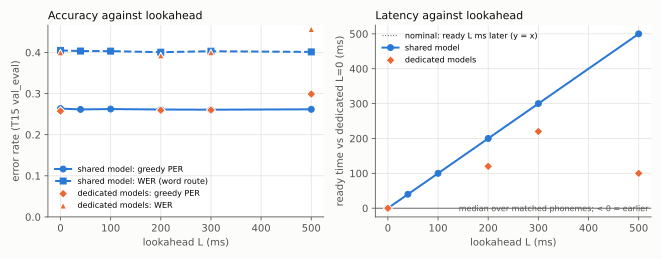

# How much accuracy does a causal decoder lose per millisecond of lookahead?

**Question:** A streaming decoder may wait L ms of future signal before it emits a frame. How do accuracy, trust outcomes and latency change with L from 0 to 500 ms? What should the NTS fields `latency` and `decoder.causal` say?

**Answer (2026-11-15, M4-12, retrained decoder; supersedes the accuracy numbers below):** With a better trained causal GRU (val_eval greedy PER 0.2574 at L = 0, was 0.6954), lookahead gives **no measurable accuracy gain**: shared model PER 0.2634 at L = 0 and 0.2608 to 0.2623 for L = 40 to 500 ms. Dedicated models at 200 and 300 ms equal L = 0 (0.2594, 0.2599); the dedicated L = 500 ms model is worse (0.2988). Its phonemes are now ready 100 ms **later** than those of the L = 0 model (median), not 180 ms earlier. The M4-02 gain was an artefact of under-training. Details: [M4-12 section](#m4-12-retrained-decoder-2026-11-15-supersedes-the-m4-0102-accuracy-numbers).

**Compute latency (2026-11-15, M4-02R, clean rerun on a quiet machine):** confirmed flat in L. Foreign load on the timing cores 1.77 % (limit 5 %; M4-02 had 5.77 %). Decoder p95 2.08 to 2.23 ms per 20 ms bin, trust p95 0.28 to 0.29 ms per frame, end of utterance p50 86.0 to 101.6 ms. The M4-12 models give the same picture. 0 commits. Details: [quiet-machine rerun](#quiet-machine-latency-rerun-2026-11-15-m4-02r).

**Old answer (2026-11-14, M4-01 / M4-02, one participant, an under-trained decoder; superseded by M4-12 for accuracy and emission timing; the compute-latency results still stand):**
- Accuracy improves fast and then flattens. Shared model greedy PER: 0.6565 at L = 0, 0.4449 at 40 ms, 0.3687 at 500 ms. Most of the gain comes in the first 40 ms.
- The real delay is **not** always L. In the shared model, phonemes are ready exactly L later. But a model **trained** with L = 500 ms emits phonemes earlier. Its phonemes are ready 180 ms **before** those of the model trained with L = 0 (median).
- Compute does not depend on L: about 2 ms per 80 ms frame for the decoder, 0.4 ms for the trust layer. The final decision after the end of the utterance does not wait for L.
- **Caveat:** our decoder is far from the published T15 decoder (PER 0.0954 at latency 0). Our L = 0 models are about 7x worse. Treat the curve shape as provisional.

Experiment: [results.md](../../experiments/2026-11-13-m4-01-02-lookahead/results.md), [tables](../../experiments/2026-11-13-m4-01-02-lookahead/results/tables.md). Data: [Brain-to-Text '25 copy task](../sources/brain-to-text-25-copytask.md) (T15, CC0).

*Left: error rates on T15 val_eval (701 trials) against L. Right: median phoneme ready time (first greedy frame + L) relative to the dedicated L = 0 model. The dotted line is the nominal delay (ready L ms later).*

## M4-12: retrained decoder (2026-11-15, supersedes the M4-01/02 accuracy numbers)
Experiment: [M4-12 results](../../experiments/2026-11-14-m4-12-decoder-retrain/results.md), pre-declared [plan](../../experiments/2026-11-14-m4-12-decoder-retrain/plan.md). Same model class, data, splits and evaluation code as M4-01/02. Only the training recipe changed, toward the published B2T '25 baseline ([source](../sources/brain-to-text-25-copytask.md); its code has no licence, so we read facts only): 10,000 steps x batch 96 (M4-01: 4,560 steps, about 53 per batch), LR 5e-3 (was 5e-4), Adam eps 0.1, Xavier / orthogonal init, input dropout 0.2, stronger noise and random cut.

**Diagnosis of M4-01/02:** about 3 % of the published training (in trial passes) at a 10x lower LR. The L = 0 model under-fitted (train CTC loss 2.43 vs 0.81 for L = 500 ms with the same GRU). So the linear lookahead branch did work that the badly trained GRU could not do.

| model | L (ms) | greedy PER M4-01/02 | **greedy PER M4-12** | WER (T = 1) M4-01/02 | **WER (T = 1) M4-12** |
|---|---|---|---|---|---|
| shared | 0 | 0.6565 | **0.2634** | 0.8907 | **0.4049** |
| shared | 40 | 0.4449 | **0.2614** | 0.6791 | **0.4034** |
| shared | 100 | 0.4097 | **0.2623** | 0.6310 | **0.4032** |
| shared | 200 | 0.3858 | **0.2612** | 0.5979 | **0.4006** |
| shared | 300 | 0.3768 | **0.2608** | 0.5803 | **0.4030** |
| shared | 500 | 0.3687 | **0.2617** | 0.5728 | **0.4013** |
| dedicated_0 | 0 | 0.6954 | **0.2574** | 0.9307 | **0.3998** |
| dedicated_10 | 200 | — | **0.2594** | — | **0.3923** |
| dedicated_15 | 300 | — | **0.2599** | — | **0.3998** |
| dedicated_25 | 500 | 0.3487 | **0.2988** | 0.5405 | **0.4565** |

- Dedicated 200 and 300 ms models equal L = 0 (0.2594, 0.2599 vs 0.2574). Only the dedicated 500 ms model is worse (it also trains worse: final train CTC loss 1.0076 vs about 0.85).
- Gap to the published decoder: 0.2574 vs 0.101 (baseline README, validation partition) and 0.0954 (online copy-task output). About 2.5x; it was about 7x.
- Emission vs dedicated L = 0 (median): dedicated 200 ms ready +120 ms, 300 ms +220 ms, 500 ms **+100 ms** (stamps −400 ms; IQR [−460, 180]). Shared model: ready exactly +L, as before.
- Frozen trust config: still 0 commits; eWPM 5.77 to 6.02, now above gaze alone (4.02) at every L.

*M4-12 models. Left: error rates on T15 val_eval (701 trials) against L. Right: median phoneme ready time relative to the dedicated L = 0 model.*

> **Our take:** On T15, our causal decoder does not gain accuracy from lookahead once the GRU is trained well. This does not prove that future context is useless: the published decoder smooths with a centred kernel (about 80 ms of future input) and is 2.5x better. But a shared model with 500 ms of lookahead is not better than L = 0, so most of that gap is training (12.5 % of the published trial passes) and recipe details, not causality. Our linear lookahead branch may also be a weak design; a delayed output or a GRU that reads the future bins could behave differently.

> **Contradiction:** M4-02 said "most of the gain comes in the first 40 ms" and "a dedicated L = 500 ms model makes phonemes ready 180 ms earlier". M4-12 does not support either claim. Both came from an under-trained L = 0 model. We keep the old numbers below for the record.

## Quiet-machine latency rerun (2026-11-15, M4-02R)
Experiment: [results](../../experiments/2026-11-15-m4-latency-quiet-rerun/results.md), [plan addendum](../../experiments/2026-11-15-m4-latency-quiet-rerun/plan.md). It used the same protocol, the same 200 trials and the original M4-01/02 code and checkpoints, in the timing CPU class (cores 8, 10, 12, 14, timing lock). The run was 2026-11-15 05:41 to 06:12, when no other job ran.

| | M4-02 (2026-11-14) | M4-02R (2026-11-15) |
|---|---|---|
| foreign load on the timing cores | 5.77 % (**not clean**) | **1.77 % (clean)** |
| SMT siblings busy | 25.23 % | 11.27 % |
| decoder push per bin p95 (ms), L 0 to 500 | 1.96 to 2.11 | 2.08 to 2.23 |
| trust push per frame p95 (ms) | 0.33 to 0.36 | 0.28 to 0.29 |
| end of utterance p50 / p95 (ms) | 79.8 to 107.5 / 148.3 to 201.0 | 86.0 to 101.6 / 158.6 to 171.4 |
| commits (frozen config) | 0 | 0 (200/200 OFFER at every L) |
| emission: dedicated L 500 vs L 0 ready time | −180 ms | −180 ms (same logits, file identical) |

- Compute does not grow with L. The quiet machine lowered the trust cost by about 20 % and narrowed the end-of-utterance p95. The decoder per-bin p95 stayed at about 2.1 ms, so the GRU step sets it, not the foreign load.
- M4-12 checkpoints (secondary condition: dedicated L 0, dedicated L 500 ms, shared at every L) gave the same picture. Decoder p95 1.70 to 2.11 ms, trust p95 0.26 to 0.32 ms, end p50 97.7 to 101.4 ms, 0 commits, and foreign load 1.56 % to 2.03 %. Their emission result was also reproduced: L 500 ms ready **+100 ms** vs L 0 (n 13,190).
- The M4-12 phase-1 stage overwrote the M4-01/02 shared-model trust decision files just before the run. So the stage's "same action" check was not valid. The rerun counted the streaming actions directly instead.

## Setup (M4-01 / M4-02)
| item | value |
|---|---|
| decoder | `fidetype.decoders.lookahead_gru`: our own causal GRU-CTC (5 layers, 768 units, 14-bin patches, stride 4 = 80 ms frames) plus a masked lookahead branch over bins `t_k + 1 .. t_k + L` |
| causality | output k uses bins `<= t_k + L` only; proved by `tests/test_causal_lookahead.py` |
| models | `shared` (L drawn per batch from {0, 40, 100, 200, 300, 500} ms), `dedicated_0` (L = 0), `dedicated_25` (L = 500 ms); 30 epochs each |
| L grid | declared 0, 50, 100, 200, 300, 500 ms; rule `floor(ms / 20)` bins, so 50 ms became **40 ms** |
| evaluation | `val_eval`: 701 trials, 41 sessions (odd-index `val` trials; checkpoint choice used the even-index ones) |
| trust | frozen Paper 1 v4 config `tcfg-f5ca0020b3b8fce2` from [M4-06](../concepts/streaming-trust-layer.md), not refitted, through `StreamingTrustLayer` |
| latency | NumPy streaming decoder fed one 20 ms bin at a time → NTS frames → `StreamingTrustLayer` with the incremental CTC beam and word decoder; 200 trials; timing CPU class |

## Results (M4-01 / M4-02, superseded for accuracy and emission)

### Accuracy and trust outcomes
| model | L (ms) | greedy PER | WER (T = 1) | sentence exact | commits | eWPM (gaze 4.02) |
|---|---|---|---|---|---|---|
| shared | 0 | 0.6565 | 0.8907 | 0.000 | 0 | 3.47 |
| shared | 40 | 0.4449 | 0.6791 | 0.006 | 0 | 4.13 |
| shared | 100 | 0.4097 | 0.6310 | 0.004 | 0 | 4.27 |
| shared | 200 | 0.3858 | 0.5979 | 0.016 | 0 | 4.44 |
| shared | 300 | 0.3768 | 0.5803 | 0.017 | 0 | 4.48 |
| shared | 500 | 0.3687 | 0.5728 | 0.014 | 0 | 4.48 |
| dedicated_0 | 0 | 0.6954 | 0.9307 | 0.000 | 0 | 3.38 |
| dedicated_25 | 500 | 0.3487 | 0.5405 | 0.034 | 0 | 5.15 |

- The frozen trust config committed nothing in all 8 conditions (701/701 OFFER, wrong-commit 0, CP95 [0.000, 0.005]). It was fitted on a much better decoder. So this test checks only the OFFER side: at L = 0 the trust layer is slower than gaze typing alone (3.47 vs 4.02 eWPM). From L = 40 ms it is faster.
- Always-commit would be wrong on 96 % to 100 % of the trials (wrong-commit 0.9629 to 1.0).
- Streaming = batch harness on 701/701 trials in every condition.

### Emission timing (median over exactly matched phonemes)
| comparison | emission stamp Δ (ms) | ready time Δ (ms) |
|---|---|---|
| shared L vs shared L = 0 | 0 | +L (40, 100, 200, 300, 500) |
| dedicated_0 vs shared L = 0 | +240 | +240 |
| dedicated_25 (L 500) vs dedicated_0 | −680 | **−180** |

### Compute latency (shared model, ms)
| L (ms) | decoder per 20 ms bin p50 / p95 | trust per frame p50 / p95 | end of utterance p50 / p95 / max |
|---|---|---|---|
| 0 | 0.04 / 2.01 | 0.24 / 0.33 | 79.8 / 148.3 / 280.6 |
| 40 | 0.09 / 1.96 | 0.24 / 0.34 | 99.6 / 188.9 / 262.6 |
| 100 | 0.08 / 2.06 | 0.25 / 0.36 | 107.5 / 201.0 / 281.0 |
| 200 | 0.09 / 2.10 | 0.25 / 0.36 | 103.1 / 180.3 / 274.4 |
| 300 | 0.09 / 2.11 | 0.25 / 0.36 | 99.4 / 193.3 / 256.3 |
| 500 | 0.07 / 1.99 | 0.24 / 0.34 | 99.5 / 173.0 / 272.1 |

The p95 per bin is the bins that complete a frame (1 in 4). The end-of-utterance cost is the word decoder's final pass; the decoder flush costs 0.4 ms or less. NumPy vs torch logits differ by at most 1.62e-04; actions match the accuracy stage on 200/200 trials at every L. The measurement environment was **not clean** (foreign load on the timing cores 5.77 %, SMT siblings busy 25.23 %; other agents ran tests). A first run gave the same picture. The clean rerun (M4-02R, 1.77 %) confirms these numbers: see [quiet-machine rerun](#quiet-machine-latency-rerun-2026-11-15-m4-02r).

> **Our take:** For a live display, a small lookahead (40 to 100 ms) buys most of the accuracy here. But the gain at L = 0 → 40 ms is so large that it may be a sign of our weak training, not a property of the data. Retest with a decoder near the published PER before we use the curve in Paper 2.

> **Our take:** The dedicated-model result is the more useful finding. A CTC model with L = 0 learns to emit late. A model with lookahead moves its emissions forward. So "L = 500 ms" can feel faster than "L = 0". Compare decoders by measured ready time, not by declared lookahead.

## What this means (M4-01/02; the accuracy advice is superseded by M4-12)

*M4-12 shows no accuracy gain from lookahead with a better trained decoder. The advice to train one model per L does not hold there (dedicated L = 500 ms was worse). The compute and NTS-field points below still stand.*

### For the streaming decoder
- Train one model per L, or at least fine-tune per L. The shared model is simple, but it is worse at 500 ms (PER 0.3687 vs 0.3487) and it does not move its emissions forward.
- L delays only the partial output. The final decision at the end of an utterance costs the same for every L (flush + word decoder, about 100 ms p50). A product can show partial text at a small L and still decide on the full utterance.
- Compute is not a limit: under 3 ms per 80 ms frame on one CPU core set.

### For the NTS fields
- `latency` = `decoder.lookahead_s` = L x 20 ms, and `decoder.causal = true` at every L, including 500 ms. This matches MET-4 and MET-5 of the [NTS 1.0 draft](../concepts/nts-spec.md): frame t uses no signal after `frame_times[t] + latency`.
- `latency` is an **upper bound on signal use**. It is not the delay a user sees: the dedicated L = 500 ms model makes phonemes ready earlier than the L = 0 model. A consumer must not rank decoders by `latency`.
- Possible 1.1 item (not a spec change now): an optional, informative field for the measured emission delay (for example the median ready-time offset on a stated test set), next to `latency`.

## Limitations
- One participant, one seed, 30 epochs; the best epoch was the last in all three runs, so the models are under-trained.
- Dedicated models only at L = 0 and 500 ms.
- The trust config was not fitted to this decoder: no commit-side result.
- Emission timing uses the greedy path and exact matches only; the L = 0 models match fewer phonemes. The last emitted phoneme is about 3.1 to 3.7 s (median) before the trial end; we did not check why.
- Compute numbers: one machine. The M4-02 environment was not clean; the M4-02R rerun (2026-11-15) was clean (foreign load 1.77 %).
- Deviations from the plan are listed in [results.md](../../experiments/2026-11-13-m4-01-02-lookahead/results.md#deviations-from-the-plan) (forced latency stage after the finished soak test, two bug fixes in the latency stage, figure reference).

## Related
- [Streaming trust layer](../concepts/streaming-trust-layer.md): the consumer of these frames.
- [NTS specification](../concepts/nts-spec.md): `latency`, `decoder.causal`, `decoder.lookahead_s`.
- [Synchronous vs asynchronous decoding](../concepts/synchronous-vs-asynchronous-decoding.md).
- [CTC](../concepts/ctc.md).
- [B2T '25 trust result](b2t25-trust-result.md): the trust layer on the published T15 decoder.
- [Architecture](architecture.md) (Paper 2: causal typing decoder).
